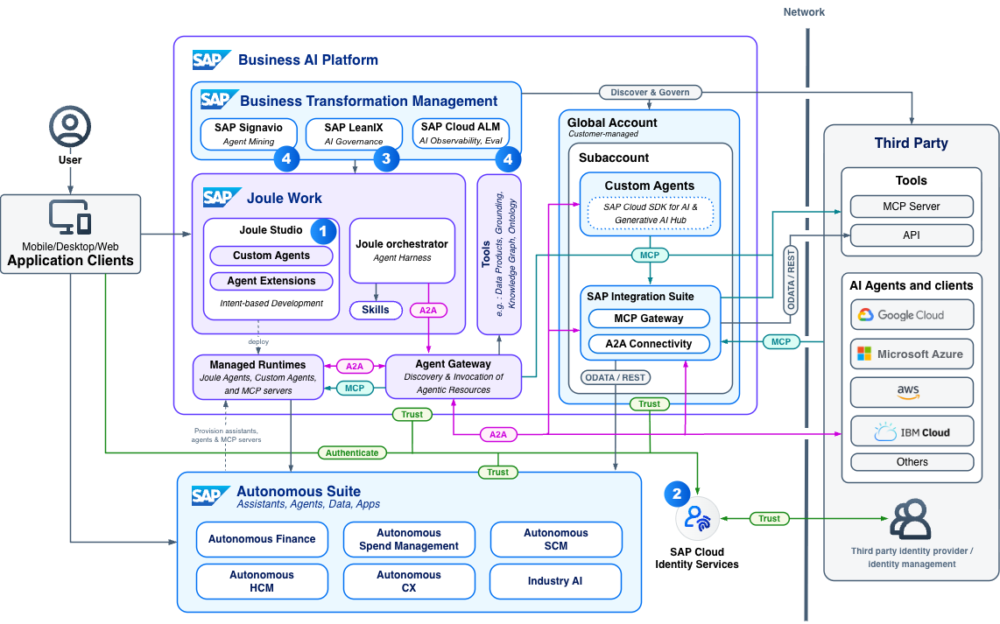

# XP270 - Get Hands-On: Build, Orchestrate & Monitor your AI Agents

## Description

This repository contains the material for the SAP TechEd 2026 session **XP270 - Get Hands-On: Build, Orchestrate & Monitor your AI Agents**.

## Overview

As AI agents move from prototype to production, the real challenge shifts from building to operating. This hands-on session gives you direct experience managing AI agents responsibly at scale on the SAP Business AI Platform — covering the orchestration, monitoring, observability, and access control patterns that enterprise deployments demand.

Across the exercises you will follow a single agent through its whole life: you'll explore and monitor a custom agent in **Joule Studio**, govern it and manage its lifecycle in the **SAP LeanIX AI Agent Hub** (together with the MCP servers it relies on and its identity in **SAP Cloud Identity Services**), observe its behaviour in **SAP Cloud ALM** and **SAP Signavio**, and see where it all fits in the reference architectures published on the **SAP Architecture Center**.

## Requirements

Basic knowledge of AI agents and the SAP Business AI Platform is recommended. No prior experience with Joule Studio or SAP LeanIX is required — we will introduce each one as we go.

## Business Scenario

Throughout this workshop you work for **GlobalFlex AG**, a manufacturer of custom industrial components. GlobalFlex runs SAP S/4HANA Cloud as its ERP backbone and has a fast-growing set of AI agents, introduced by different lines of business — often without central visibility. You are part of the newly established **AI Governance Center of Excellence**, and your job is to operate these agents responsibly: understand what they do, keep them observable, govern their lifecycle, and control who can access them.

The agent at the centre of the story is a **finance agent** running on Joule Studio. You will not build it from scratch — it has been pre-provisioned for you — so you can focus on operating it end to end.

## Exercises

- [Getting Started](exercises/ex0/README.md)
- [Exercise 1 - Agents and the reference architecture](exercises/ex1/README.md)
- [Exercise 2 - Explore and monitor your agent in Joule Studio](exercises/ex2/README.md)
- [Exercise 3 - Govern your agent in the SAP LeanIX AI Agent Hub](exercises/ex3/README.md)
- [Exercise 4 - Manage access with SAP Cloud Identity Services](exercises/ex4/README.md)
- [Exercise 5 - Observe your agent in SAP Cloud ALM](exercises/ex5/README.md)
- [Exercise 6 - Observe agent behaviour with SAP Signavio](exercises/ex6/README.md)

The system details and credentials you need are listed once, in [Getting Started](exercises/ex0/README.md).

## Related Sessions

This workshop is the hands-on complement to the following sessions in the **Build Enterprise-Grade AI Governance as a Foundation** subtrack. Attending them before or after this workshop will deepen your understanding.

| Session | Type | Title | Why it's relevant to this workshop |
|---------|------|-------|-------------------------------------|
| ST127 | Strategy Talk | Scale AI with confidence with governance built for the agentic era | Frames the problem this workshop solves — AI spreading faster than organizations can govern it |
| BT102 | Deep Dive | From AI sprawl to AI governance with SAP AI Agent Hub | Deep-dive on the product you will use in this workshop; ideal preparation if you are new to SAP AI Agent Hub |
| BT116 | Deep Dive | How SAP SE governs AI sprawl with SAP AI Agent Hub | Real-world use case from SAP's own corporate IT team — the governance workflow in practice |
| BT115 | Deep Dive | Monitor your AI agents with the SAP Cloud ALM solution | Covers the observability layer that sits alongside governance — what happens after you verify an agent |
| BT800 | Road Map | SAP LeanIX solutions road map for AI-native enterprise architecture | What's coming next for the platform underlying this workshop |

## Contributing

Please read the [CONTRIBUTING.md](./CONTRIBUTING.md) to understand the contribution guidelines.

## Code of Conduct

Please read the [SAP Open Source Code of Conduct](https://github.com/SAP-samples/.github/blob/main/CODE_OF_CONDUCT.md).

## How to obtain support

Support for the content in this repository is available during the actual time of the online session for which this content has been designed. Otherwise, you may request support via the [Issues](../../issues) tab.

## License

Copyright 2026 SAP SE or an SAP affiliate company and <your-project> contributors. Please see our [LICENSE](LICENSE) for copyright and license information. Detailed information including third-party components and their licensing/copyright information is available [via the REUSE tool](https://api.reuse.software/info/github.com/SAP-Samples/teched2026-XP270).
