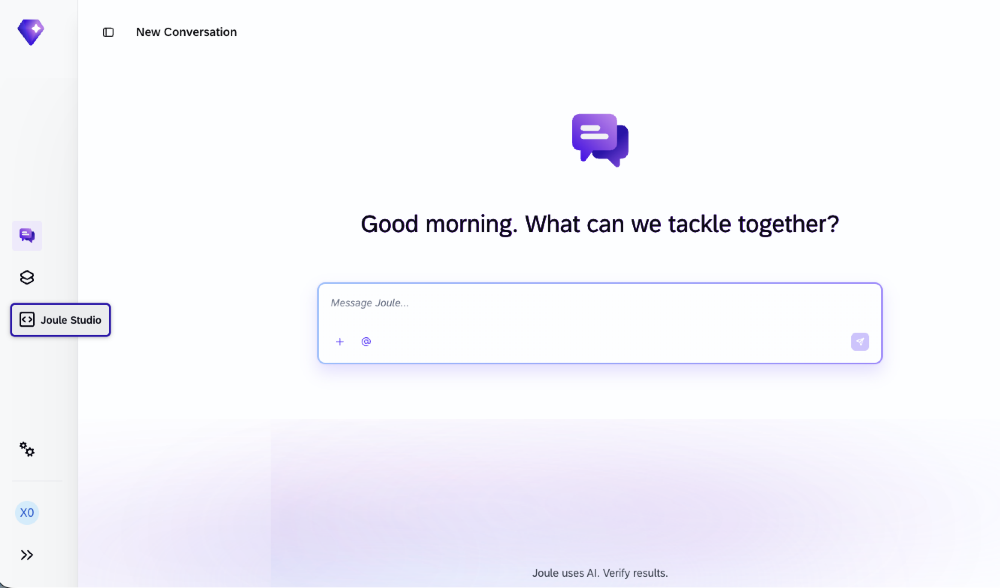
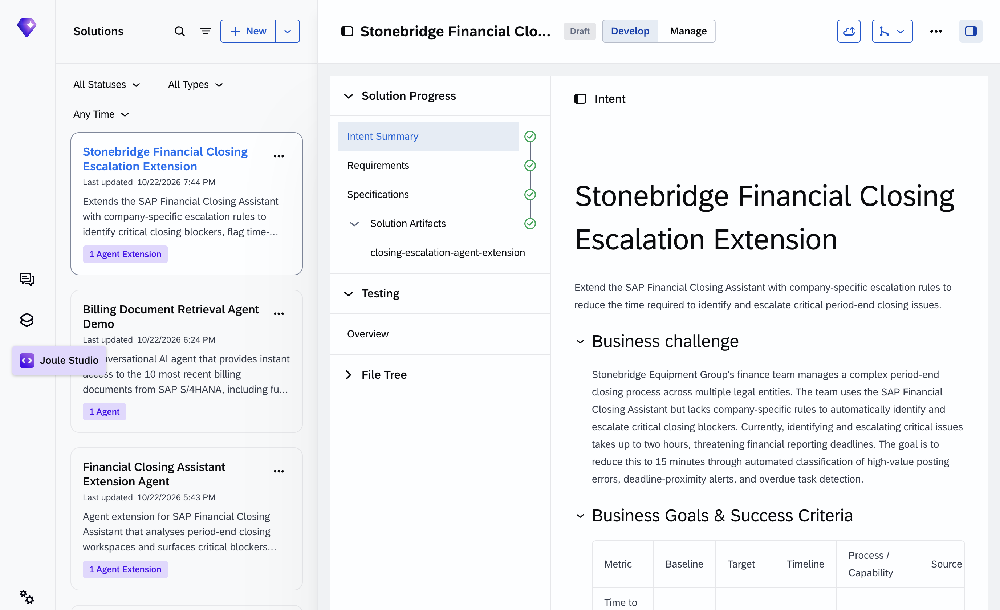
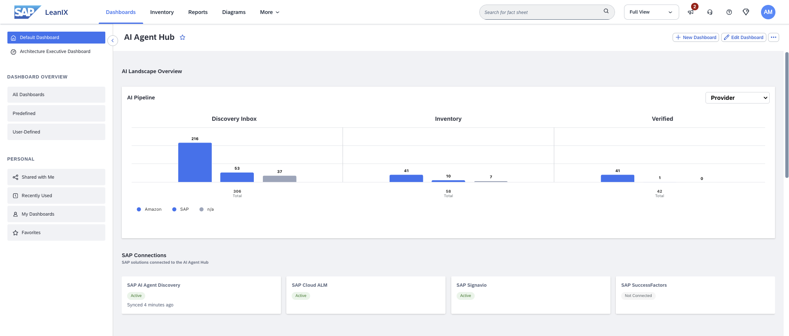
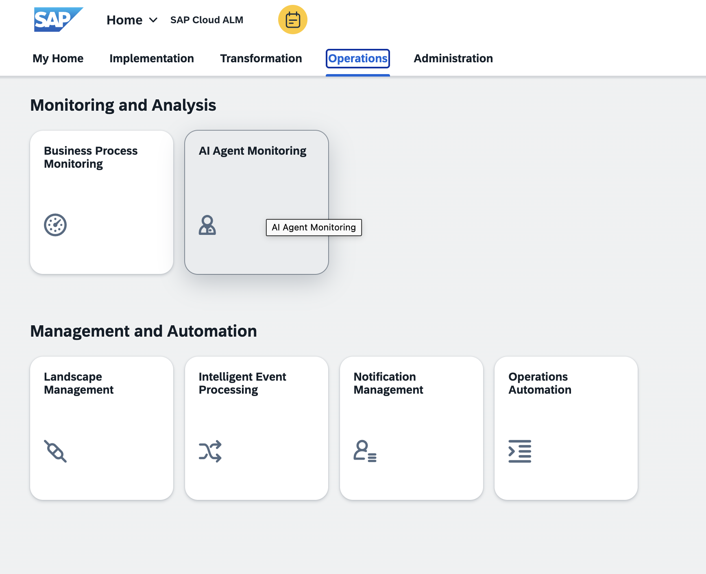

# Exercise 00 - Getting Started

Before we start operating our AI agent, let's make sure you can reach the systems we will use during the session and get your bearings in each one.

In this session you take the role of a member of the **AI Governance Center of Excellence** at **GlobalFlex AG** (see the [business scenario](../../README.md#business-scenario) in the main README). A custom finance agent has already been deployed on Joule Studio. Over the next exercises you will explore it, monitor it, govern it, and observe how it behaves — the full "day in the life" of operating an agent at scale.

At the end of this exercise, you'll have successfully logged in to the systems you need and understood what each one is for.

> [!IMPORTANT]
> ***System details and credentials for this exercise 🔐***   
> These are the systems you will use. They are listed **once, here** — later exercises refer to them by name. Your trainer will share the actual URLs and credentials at the start of the session; wherever you see a `<PLACEHOLDER>` below, use the value provided to you.
>
> | System | URL | Credentials |
> | ---- | ---- | ---- |
> | Joule Studio | https://url.sap/fc8j65 | User `XP270-0NN` (your participant number) |
> | SAP LeanIX — AI Agent Hub | https://url.sap/9rm72k | User `XP270-0NN` (your participant number) |
> | SAP Cloud Identity Services | N/A | Presenter demo — no login required |
> | SAP Cloud ALM | https://url.sap/a3ml53 | User `XP270-0NN` (your participant number) |
> | SAP Signavio | https://url.sap/p851or | User `XP270-0NN` (your participant number) |

## Your participant number

Every participant has their own Joule Studio user and their own copy of the finance agent so you can work without affecting anyone else.

👉 Note your **participant number** — it is the two-digit suffix of your Joule Studio user, in the form `XP270-0NN` (for example, `XP270-007`, where your number is `07`). You will reuse this number throughout the session to login to the different systems.

## The systems you will use

Take two minutes to understand what each system is for before we start.

- **Joule Studio** is SAP's AI-first environment to create and run AI agents, apps, and workflows — from intent to deployment. It is where our agent was built, deployed, and where its runtime monitoring lives. You reach it through **Joule Work**, the intelligent workspace that coordinates AI across the organization.
- **SAP LeanIX** is SAP's enterprise architecture management platform. Its **AI Agent Hub** module is where we govern agents, MCP servers, and LLMs across the whole landscape — SAP-native, custom, and third-party.
- **SAP Cloud Identity Services** manages the identity, authentication, and authorizations behind each agent.
- **SAP Signavio** analyses how agents actually behave, by mining their execution traces.
- **SAP Cloud ALM** provides the operations dashboards that track agent performance in production.

## Log in

> [!IMPORTANT]
> Do not make any changes in any of the systems yet. We will start working in each system through the exercises, beginning with Exercise 3. For now, just confirm you can log in.

### Joule Studio

👉 Open **Joule Studio** and sign in with your `XP270-0NN` user. You should land in Joule Work, with Joule Studio reachable from the main navigation.

👉 Select **Joule Studio** from the main navigation in Joule Work.

### SAP LeanIX AI Agent Hub

👉 In a new tab, open the **SAP LeanIX** and sign in with the shared workspace credentials. From the LeanIX home, open the **AI Agent Hub** — this is where Exercises 3 takes place.

> [!NOTE]
>
> The first time you login, it is likely that you will need to set a job role and what you will use the system for. Select the appropriate options, e.g. *Enterprise Architect* and *Establish architecture transparency and practices* respectively and continue by selecting **Submit**.

### SAP Cloud ALM

👉 In a new tab, open **SAP Cloud ALM** and sign in with the shared workspace credentials. From the Cloud ALM home, navigate to the **Operations** tab. You'll find here the **AI Agent Monitoring** tile — this is where Exercises 5 take place.

## Summary

You now have access to Joule Studio, the SAP LeanIX AI Agent Hub and SAP Cloud ALM, you know your participant number, and you have a general idea of what each system in the landscape is for. In the next exercise we'll step back and look at what an agent actually *is* on the SAP Business AI Platform, and where all these systems fit in the reference architecture.

## Further Study

* [What is Joule Studio?](https://help.sap.com/docs/joule-studio/joule-studio/what-is-joule-studio?locale=en-US)
* [SAP Business AI Platform](https://www.sap.com/products/artificial-intelligence.html)

## Next

Continue to 👉 [Exercise 01 - Agents and the reference architecture](../ex1/README.md)
