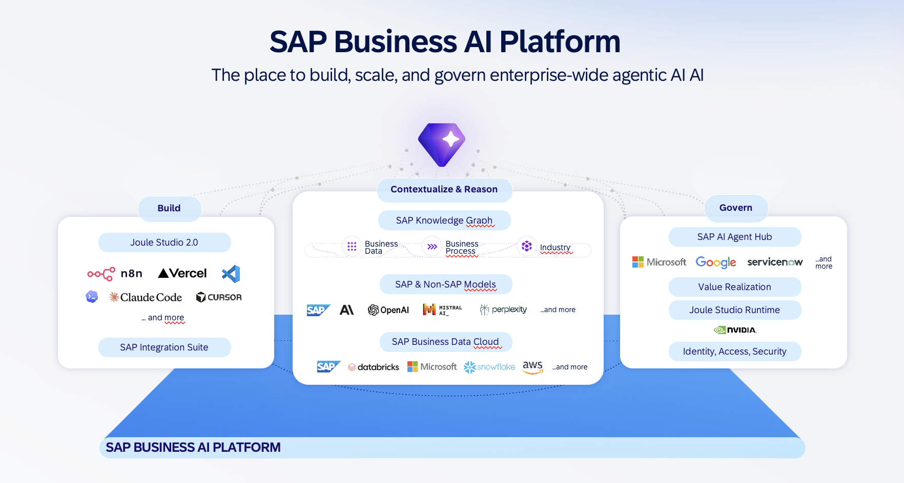
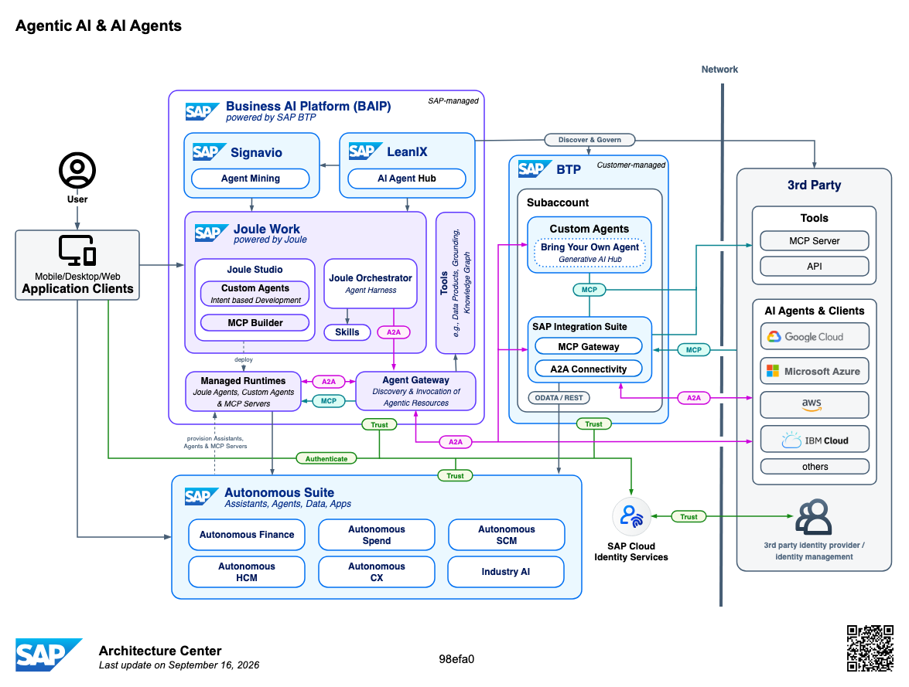

# Exercise 01 - Agents and the reference architecture

Now that you can reach the systems, let's build a shared understanding before we start clicking. Operating an agent responsibly is much easier once you know what an agent actually *is* on the SAP Business AI Platform, and how the systems you logged in to fit together.

At the end of this exercise, you'll have an understanding of what an AI agent is in Joule Studio and how the SAP Business AI Platform brings building, reasoning, and governance together — the mental model for everything that follows.

## What is an AI agent?

In Joule Studio, an **agent** is an AI-powered assistant that understands natural language, accesses SAP data, and executes tasks. Rather than a fixed, hard-coded program, it combines a large language model with tools, instructions, and the ability to decide what to do next. Concretely, an agent:

- **Understands natural language** — you ask questions or give commands in plain language.
- **Accesses SAP systems** — it connects to SAP S/4HANA and other backends through **MCP (Model Context Protocol)** tools, routed via the **Agent Gateway**.
- **Uses tools and skills** — a **skill** is a specific capability the agent can perform (for example, retrieving invoice data or calculating a financial impact). Skills define the scope of what the agent can do.
- **Makes decisions** — it determines which APIs to call based on the context of the conversation.
- **Communicates with other agents** — it can discover and invoke other agents through the **A2A (Agent-to-Agent)** protocol.

> [!NOTE]
> Every agent carries an **Agent Card** — its identity and capabilities (name, description, version, and the skills it exposes). You will see our finance agent's card in the next exercise, and the same card is what makes the agent discoverable across the landscape.

> [!IMPORTANT]
> All SAP system access goes through the **Agent Gateway** — a single, governed connection point. There is no direct database access and no uncontrolled connections. This matters for everything we do later: access is governed by your organization's existing authorization model, which is exactly what makes an agent safe to operate at scale.

## The SAP Business AI Platform: build, reason, govern

Our finance agent does not live in isolation — it sits on the **SAP Business AI Platform**, which the reference architecture organizes around three pillars:

| Pillar | What it provides | Where you'll see it today |
|--------|------------------|---------------------------|
| **Build** | Development tools for agents and workflows | Joule Studio (Exercise 2) |
| **Contextualize and Reason** | Harmonized business data and domain knowledge the agent reasons over | The SAP S/4HANA data our agent reads via the Agent Gateway |
| **Govern** | Lifecycle management, compliance, and observability | SAP LeanIX AI Agent Hub, Cloud ALM, Signavio (Exercises 3 to 6) |

This is the arc of the whole session: we **build and run** in Joule Studio, we **reason** over governed SAP data, and we **govern and observe** everything through the AI Agent Hub and the observability tools around it.

## Where governance and observability come from

A few supporting components make "operate at scale" possible — keep these names in mind, because you'll meet each one:

- **SAP LeanIX (AI Agent Hub)** — the vendor-agnostic command centre for discovering and governing AI agents, MCP servers, and LLMs across the landscape.
- **SAP Cloud Identity Services** — manages agent identities and authorizations. The effective permission at runtime is the *intersection* of the user's permissions and the agent's permissions.
- **SAP Cloud ALM** and **SAP Signavio** — receive execution telemetry so you can monitor performance and mine actual behaviour.

## See the reference architecture for yourself

These patterns are published and maintained on the **SAP Architecture Center** — SAP's home for reference architectures and architecture guidelines. It is worth knowing where to find them when you design your own agentic solutions.

👉 Open the **Agentic AI and AI Agents on SAP Business AI Platform** reference architecture and check out the solution diagram: [architecture.learning.sap.com/docs/ref-arch/98efa0](https://architecture.learning.sap.com/docs/ref-arch/98efa0)

👉 Open the **AI Agent Hub** reference architecture and note how discovery, governance, and observability connect: [architecture.learning.sap.com/docs/ref-arch/jkg4j2](https://architecture.learning.sap.com/docs/ref-arch/jkg4j2).

SAP AI Agent Hub is the enterprise command center for AI governance: a single platform that brings enterprise architecture discipline to AI agent management, built on SAP LeanIX.

The hub addresses a fundamental challenge: while building and deploying individual agents is increasingly straightforward, governing the resulting landscape at scale is not. SAP AI Agent Hub makes the agent estate visible, manageable, and compliant — from the initial planning of a new agent through to its eventual decommissioning.

## Summary

We now share a working definition of an agent — natural language in, governed SAP access out, via skills and the Agent Gateway — and a map of the SAP Business AI Platform's build / reason / govern pillars. We also know these patterns live on the SAP Architecture Center. In the next exercise we'll stop looking at diagrams and open our actual finance agent in Joule Studio.

## Further Study

* [Agents in Joule Studio](https://help.sap.com/docs/joule-studio/joule-studio/agents?locale=en-US)
* [Agentic AI and AI Agents on SAP Business AI Platform (reference architecture)](https://architecture.learning.sap.com/docs/ref-arch/98efa0)
* [AI Agent Hub (reference architecture)](https://architecture.learning.sap.com/docs/ref-arch/jkg4j2)
* [Agent2Agent Protocol](https://a2a-protocol.org/latest/)

## Next

Continue to 👉 [Exercise 02 - Explore and monitor your agent in Joule Studio](../ex2/README.md)
