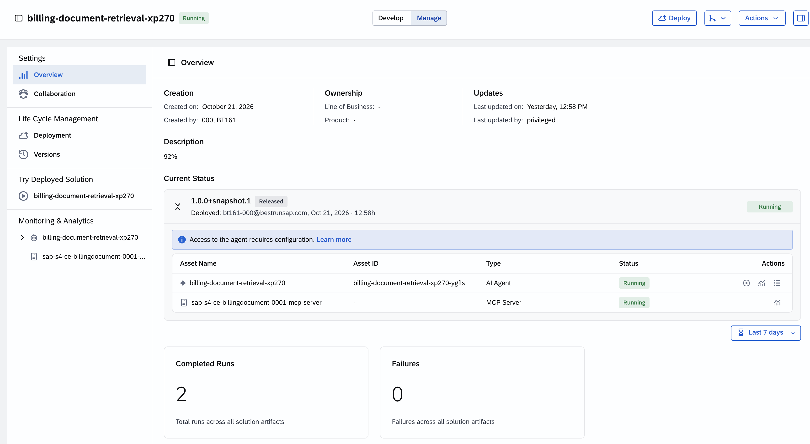
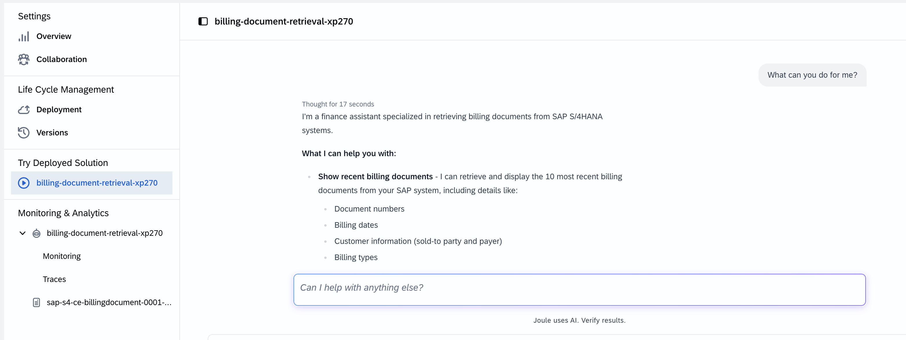
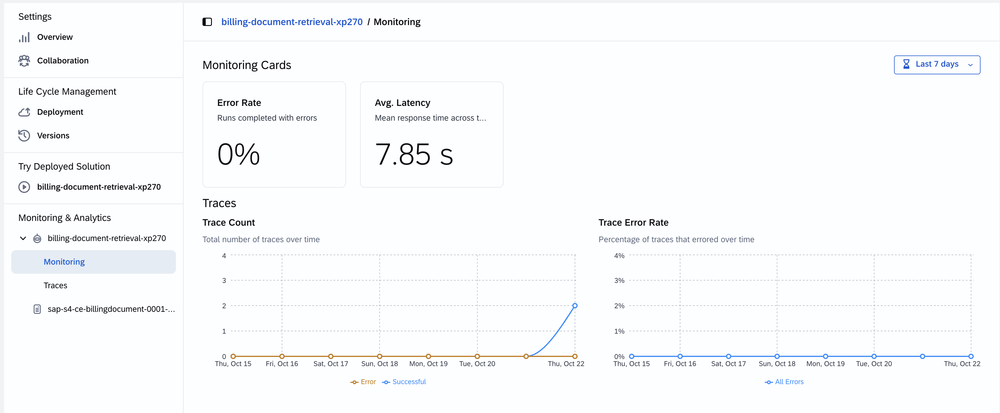
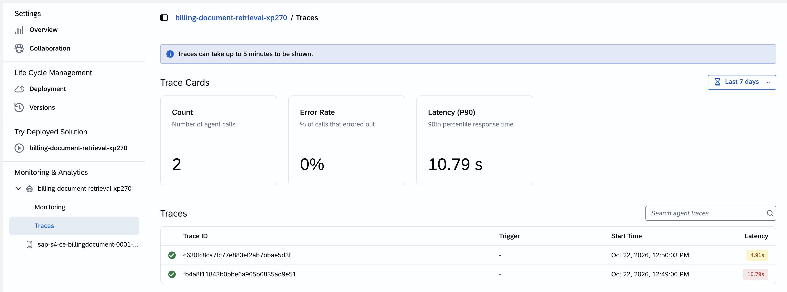

# Exercise 02 - Explore and monitor your agent in Joule Studio

In a previous exercise we described what an agent is. Now let's meet the real one. GlobalFlex AG's finance team deployed a custom agent on Joule Studio to tackle a very concrete problem — and as the people responsible for operating it, our first job is to understand what it does and whether it is healthy.

At the end of this exercise, you'll have successfully explored the finance agent in Joule Studio and used its built-in observability to judge whether it is running well.

## The agent we are operating

The finance team needs faster access to the 10 most recent billing documents from SAP S/4HANA. Our Billing Document Retrieval agent grants us access to the recent billing documents from SAP S/4HANA without having to navigate through SAP screens manually. It provides our finance team with full document details — including status, billing type, and payer — available instantly through a conversational agent.

> [!NOTE]
> You do not need to build this agent — it has been pre-provisioned for the workshop. It was created in Joule Studio following the **intent-based development** approach: someone described the outcome they wanted in plain language, and Joule Studio guided them from intent, through a requirements and specification step, to a deployed, monitored solution. In this session we join the story *after* deployment, at the operate stage.

## Step 1 — Open the Billing Document Retrieval agent

👉 In **Joule Studio**, open the solution that contains the ***Billing Document Retrieval agent for XP270***. We land in the **Develop** tab where we can find the solution's artifacts, including the agent itself, its tools (MCP servers), and other related components.

👉 Review the Intent, Requirements, and Specifications. This will give you a good understand of the agent is capable of and how it is expected to operate.

👉 Look at the Solution Artifacts. Connectivity to the SAP S/4HANA Cloud system is established **once**, during deployment, through the **Agent Gateway**, and reused consistently. Mock data is available for testing purposes.

> [!TIP]
> We can test the agent with mock data from the **Preview with Mock data** > **billing-document-retrieval-xp270** section.

## Step 2 — The Manage Tab

👉 Go to the **Manage** tab

- Settings:
  - Overview: Our agent is deployed, in this page we can get an overview of the agent and its deployment status. Also, through this page you have built-in observability to track its performance, inspect individual runs, and investigate failures.
  - Collaboration: The Collaboration feature lets you share a solution with other users in your organization, so you can work together on it. As a solution owner, you control who has access and what they can do.
- Lifecycle Management: 
  - Deployments: We can see all deployments of the solution to the managed environment and their status. 
  - Version: From here, we see the different versions of the solution, which one is the current version and we can undeploy the current solution.
- Try Deployed Solution: This section allows you to test the deployed agent to ensure it is functioning as expected.
    

## Step 3 — Read the Monitoring & Analytics section

👉 In the Manage tab of the agent, the agent name will be listed under **Monitoring & Analytics**.

You will find two sub-sections. We'll look at each in turn:

- **Monitoring** — aggregated performance over a period
- **Traces** — the detail of individual runs

> [!NOTE]
> You may need to wait up to five minutes for trace data to appear after an agent run completes. The system retains this data for **3 months**.

The **Monitoring** sub-page summarizes how your custom agent has performed over the selected period. Start with the two summary cards:

| Card | What it shows |
|------|---------------|
| **Error Rate** | Percentage of traces that resulted in an error over the selected period |
| **Avg. Latency** | Average end-to-end trace duration, in seconds |

👉 Below the cards, review the three time-series charts and ask what each one is telling you:

- **Trace Count** — total traces over time, split into **Successful** and **Error**. If the error count rises while total volume stays flat, suspect a configuration or model change rather than more traffic. If both rise together, the agent may be hitting a resource or rate limit under load.
- **Trace Error Rate** — the percentage of traces that errored, plotted daily. A spike that recovers within a day usually means a transient external dependency; a sustained rise that starts on a specific day is a strong signal that a deployment or prompt change introduced a regression.
- **Trace Latency** — end-to-end duration as three percentile lines, **P50**, **P90**, and **P99**. When P50 and P90 are close and stable, the agent is consistent. A widening gap to P99 means a minority of runs are much slower — often a slow tool call, a retrying API, or a model timeout on long inputs.

> [!IMPORTANT]
> As the person operating a change, check this view immediately **after** deploying one. Set the time range to cover a period before and after the deployment, and confirm the error rate and latency have not moved meaningfully. A longer prompt, for example, increases inference time — so a prompt change can quietly raise latency.

## Step 4 — Inspect Traces

👉 Open the **Traces** sub-page. A trace is the full record of one agent run. In day-to-day operations, this is the view the operations team shares with a developer when they hit a failing run they cannot resolve — they pass the **trace ID**, and the developer opens that exact trace here to investigate the root cause.

> [!TIP]
> The agent traces are synced to Cloud ALM automatically, allowing you to correlate trace data with other operational and development activities in the cloud environment. Also, the aggregated trace data is synced from Cloud ALM to The AI Agent Hub in LeanIX. We will see this in future exercises.

## Summary

We've met our agent, understood what it does and how it reaches SAP S/4HANA through the Agent Gateway, and are now familiar with the Manage section in Joule Studio to understand Monitoring & Analytics that we have available for our agent, e.g. its health — error rate, latency percentiles, evaluation quality, and individual traces. That is the "operate" view from the *build* side. But Joule Studio only sees agents it runs. In the next exercise we'll switch to the governance side and see our agent appear in the SAP LeanIX AI Agent Hub, alongside every other agent in the landscape.

## Further Study

* [Monitoring a Solution in Joule Studio](https://help.sap.com/docs/joule-studio/joule-studio/monitoring-solution?locale=en-US)
* [Agents in Joule Studio](https://help.sap.com/docs/joule-studio/joule-studio/agents?locale=en-US)

## Next

Continue to 👉 [Exercise 03 - Govern your agent in the SAP LeanIX AI Agent Hub](../ex3/README.md)
