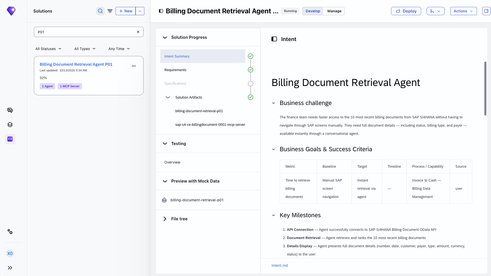

# Exercise 02 - Explore and monitor your agent in Joule Studio

In a previous exercise we described what an agent is. Now let's meet the real one. GlobalFlex AG's finance team deployed a custom agent on Joule Studio to tackle a very concrete problem — and as the people responsible for operating it, our first job is to understand what it does and whether it is healthy.

At the end of this exercise, you'll have successfully explored your finance agent in Joule Studio and used its built-in observability to judge whether it is running well.

## The agent we are operating

Our agent performs a **missed discount analysis**. GlobalFlex AG loses money when unmatched invoices go unnoticed and early-payment discounts expire. The agent reads unmatched invoices from SAP S/4HANA, calculates the lost early-payment discounts, and quantifies the financial impact of delayed or missed payments.

> [!NOTE]
> You do not need to build this agent — it has been pre-provisioned for your `XP270-0NN` user. It was created in Joule Studio following the **intent-based development** approach: someone described the outcome they wanted in plain language, and Joule Studio guided them from intent, through a requirements and specification step, to a deployed, monitored solution. In this session we join the story *after* deployment, at the operate stage.

## Step 1 — Open your agent

👉 In **Joule Studio**, open the solution that contains your missed discount analysis agent. Use your participant number (`XP270-0NN`) to find *your* copy.

👉 Review the agent's **Agent Card** and **skills**. The card gives the agent its identity (name, description, version); the skills define what it can actually do — here, reading unmatched invoices, calculating lost discounts, and quantifying the financial impact.

> [!TIP]
> Look at how the agent reaches SAP S/4HANA. Connectivity is established **once**, during deployment, through the **Agent Gateway**, and reused consistently — there is no direct database access. This is the governed connection point we discussed in Exercise 1.

## Step 2 — Open Monitoring & Analytics

Once an agent is deployed, Joule Studio gives you built-in observability to track its performance, inspect individual runs, and investigate failures.

👉 Open your agent and select **Manage → Monitoring & Analytics**.

You will find three sub-pages. We'll look at each in turn:

- **Monitoring** — aggregated performance over a period
- **Evaluations** — quality of the agent's responses
- **Traces** — the detail of individual runs

> [!NOTE]
> You may need to wait up to five minutes for trace data to appear after an agent run completes. The system retains this data for **90 days**.

## Step 3 — Read the Monitoring page

The **Monitoring** sub-page summarizes how your custom agent has performed over the selected period. Start with the two summary cards:

| Card | What it shows |
|------|---------------|
| **Error Rate** | Percentage of traces that resulted in an error over the selected period |
| **Avg. Latency** | Average end-to-end trace duration, in seconds |

👉 Below the cards, review the three time-series charts and ask what each one is telling you:

- **Trace Count** — total traces over time, split into **Successful** and **Error**. If the error count rises while total volume stays flat, suspect a configuration or model change rather than more traffic. If both rise together, the agent may be hitting a resource or rate limit under load.
- **Trace Error Rate** — the percentage of traces that errored, plotted daily. A spike that recovers within a day usually means a transient external dependency; a sustained rise that starts on a specific day is a strong signal that a deployment or prompt change introduced a regression.
- **Trace Latency** — end-to-end duration as three percentile lines, **P50**, **P90**, and **P99**. When P50 and P90 are close and stable, the agent is consistent. A widening gap to P99 means a minority of runs are much slower — often a slow tool call, a retrying API, or a model timeout on long inputs.

> [!IMPORTANT]
> As the person operating a change, check this view immediately **after** deploying one. Set the time range to cover a period before and after the deployment, and confirm the error rate and latency have not moved meaningfully. A longer prompt, for example, increases inference time — so a prompt change can quietly raise latency.

## Step 4 — Inspect Evaluations and Traces

👉 Open the **Evaluations** sub-page to see how the quality of the agent's responses is scored over time. Use it to confirm that a change did not cause a regression in answer quality, not just in errors or latency.

👉 Open the **Traces** sub-page. A trace is the full record of one agent run. In day-to-day operations, this is the view the operations team shares with a developer when they hit a failing run they cannot resolve — they pass the **trace ID**, and the developer opens that exact trace here to investigate the root cause.

> [!TIP]
> Think about the division of labour this enables: operations watches production health and fields user requests, while developers use Evaluations and Traces to validate changes and chase down specific failures. The trace ID is the handoff between the two.

## Summary

We've met our finance agent, understood what it does and how it reaches SAP S/4HANA through the Agent Gateway, and used Joule Studio's Monitoring & Analytics to read its health — error rate, latency percentiles, evaluation quality, and individual traces. That is the "operate" view from the *build* side. But Joule Studio only sees agents it runs. In the next exercise we'll switch to the governance side and see our agent appear in the SAP LeanIX AI Agent Hub, alongside every other agent in the landscape.

## Further Study

* [Monitoring a Solution in Joule Studio](https://help.sap.com/docs/joule-studio/joule-studio/monitoring-solution?locale=en-US)
* [Agents in Joule Studio](https://help.sap.com/docs/joule-studio/joule-studio/agents?locale=en-US)

## Next

Continue to 👉 [Exercise 03 - Govern your agent in the SAP LeanIX AI Agent Hub](../ex3/README.md)
