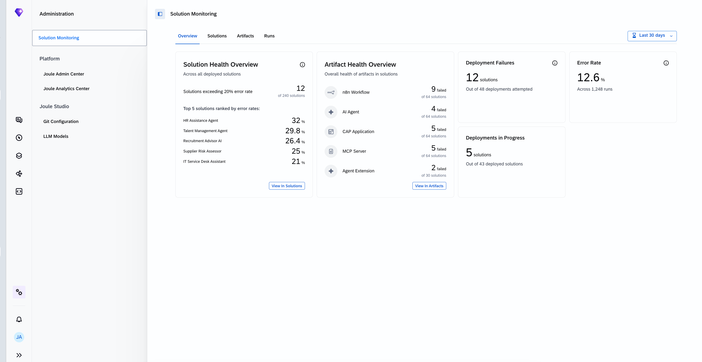
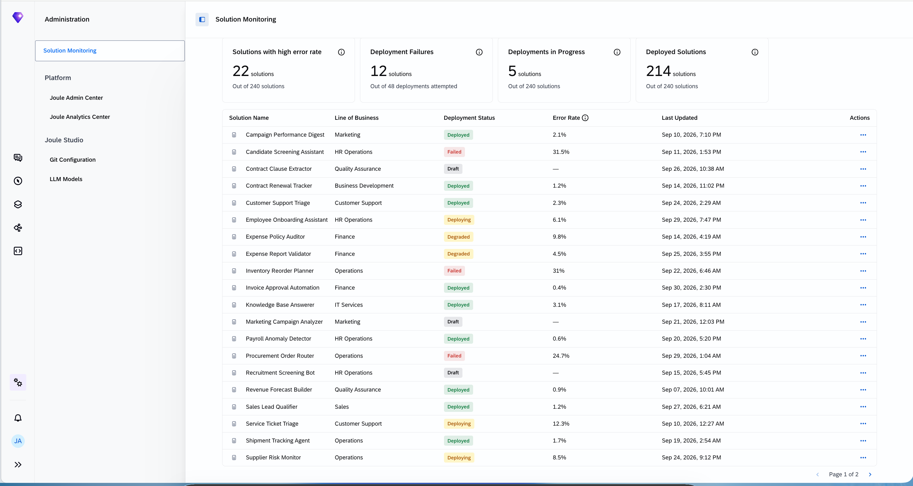
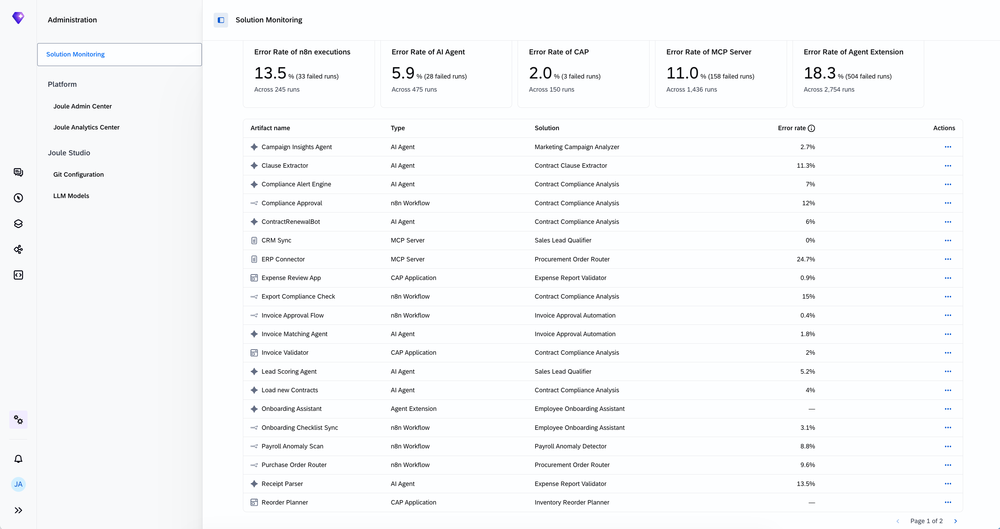
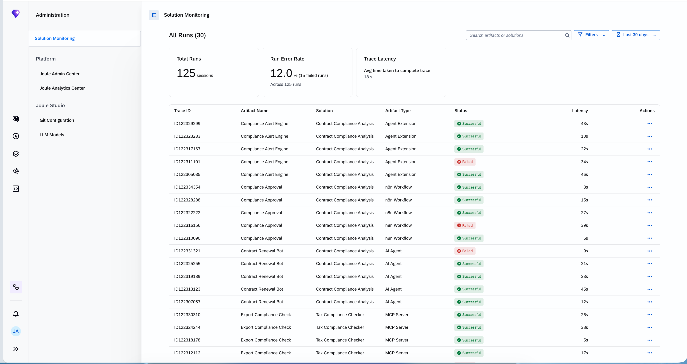

# Exercise 02 - Explore and monitor your agent in Joule Studio

In a previous exercise we described what an agent is. Now let's meet the real one. GlobalFlex AG's finance team deployed a custom agent on Joule Studio to tackle a very concrete problem — and as the people responsible for operating it, our first job is to understand what it does and whether it is healthy.

At the end of this exercise, you'll have successfully explored the finance agent in Joule Studio and used its built-in observability to judge whether it is running well.

> [!IMPORTANT]
> ***System details and credentials for this exercise 🔐***   
> The table below shows the system you will use in this exercise. Refer to [Exercise 00](../ex0/README.md) for the full credentials list.
>
> | System | URL | Credentials |
> | ---- | ---- | ---- |
> | Joule Studio | https://url.sap/fc8j65 | User `XP270-0NN` (your participant number) |

## Step 0 - Understand the agent

The finance team needs faster access to the 10 most recent billing documents from SAP S/4HANA Cloud. Our Billing Document Retrieval agent grants us access to the recent billing documents from SAP S/4HANA Cloud without having to navigate through SAP screens manually. It provides our finance team with full document details — including status, billing type, and payer — available instantly through a conversational agent.

**You do not need to build this agent** — it has been pre-provisioned for the workshop. It was created in Joule Studio following the **intent-based development** approach: by describing the outcome in plain language, and Joule Studio guided the development from intent, through requirements and specification, to a deployed, monitored solution. Building and deploying the agent from scratch will take a significant amount of time for the limited duration of this workshop. In this session we join the story *after* deployment, at the operate stage.

> [!TIP]
> Interested in building as many agents as you want? **Visit the Developer Garage in Hall 1.2**. There you can find resources, guidance, and support for creating your own agents.

## Step 1 - Open the Billing Document Retrieval agent

👉 In **Joule Studio**, open the solution that contains the ***Billing Document Retrieval agent for XP270***. We land in the **Develop** tab where we can find the solution's artifacts, including the agent itself, its tools (MCP servers), and other related components.

👉 Review the Intent, Requirements, and Specifications. This will give you a good understand of the agent is capable of and how it is expected to operate.

👉 Look at the Solution Artifacts. Connectivity to the SAP S/4HANA Cloud system is established **once**, during deployment, through the **Agent Gateway**, and reused consistently. Mock data is available for testing purposes.

> [!TIP]
> We can test the agent with mock data from the **Preview with Mock data** > **billing-document-retrieval-xp270** section.

## Step 2 - Developer-level observability

Joule Studio provides built-in **developer-level** observability that operates at two complementary levels at the solution level:

- **Solution-level aggregation** — a consolidated, cross-asset health view of everything deployed in a solution
- **Asset-level monitoring and tracing** — deep inspection of individual agent runs, workflow executions, and model calls

Joule Studio also provides an admin view that helps the **admin** of the tenant understand:

- **Solution health overview** - a consolidated list of all solutions in the tenant, along with their status
- **Artifact health overview** - a list of all artifacts along with their health
- **Trace-level information for each artifact**- to allow admins to quickly investigate issues.

👉 Navigate to the **Manage** tab

### Solution Overview

The **Overview tab** in the Manage section of the solution provides a single-pane view of the observable state of every asset within that solution.

The **Solution Assets table** lists every asset in the solution — CAP applications, n8n workflows, AI agents, agent extensions.

**Summary cards** at the overview tab surface the most operationally relevant indicators at a glance:

| Card | What it tells you |
|---|---|
| Completed Runs | Successfully finished solution runs |
| Failures | Solution runs that have errors |

> [!TIP]
> We can also test the deployed solution directly from this section by going to selecting the agent (***billing-document-retrieval-xp270***) within the **Try Deployed Solution** section.
> 

### The Monitoring & Analytics section

The **Monitoring & Analytics** tab in the Manage section lists all the solution artifacts. The user can drill down into each artifact type to see the relevant details.

👉 In the Manage tab of the agent, the agent name will be listed under **Monitoring & Analytics**.

For the agent, you will find two sub-sections. We'll look at each in turn:

- **Monitoring** — aggregated performance over a period
- **Traces** — the detail of individual runs

> [!NOTE]
> All observability views share a consistent **time filter** that lets you scope the data to the period that matters. You may need to wait up to five minutes for trace data to appear after an agent run completes. The system retains this data for **3 months**.

The **Monitoring** sub-page summarizes how your custom agent has performed over the selected period. Start with the two summary cards:

| Card | What it shows |
|------|---------------|
| **Error Rate** | Percentage of traces that resulted in an error over the selected period |
| **Avg. Latency** | Average end-to-end trace duration, in seconds |

👉 Below the cards, review the three time-series charts and ask what each one is telling you:

- **Trace Count** — total traces over time, split into **Successful** and **Error**. If the error count rises while total volume stays flat, suspect a configuration or model change rather than more traffic. If both rise together, the agent may be hitting a resource or rate limit under load.
- **Trace Error Rate** — the percentage of traces that errored, plotted daily. A spike that recovers within a day usually means a transient external dependency; a sustained rise that starts on a specific day is a strong signal that a deployment or prompt change introduced a regression.
- **Trace Latency** — end-to-end duration as three percentile lines, **P50**, **P90**, and **P99**. When P50 and P90 are close and stable, the agent is consistent. A widening gap to P99 means a minority of runs are much slower — often a slow tool call, a retrying API, or a model timeout on long inputs.

> [!IMPORTANT]
> As the person operating a change, check this view immediately **after** deploying one. Set the time range to cover a period before and after the deployment, and confirm the error rate and latency have not moved meaningfully. A longer prompt, for example, increases inference time — so a prompt change can quietly raise latency.

### Inspect Traces

When a metric signals a problem, the **Traces tab** lets you drill all the way down to individual runs.

👉 Open the **Traces** sub-page. A trace is the full record of one agent run. In day-to-day operations, this is the view the operations team shares with a developer when they hit a failing run they cannot resolve — they pass the **trace ID**, and the developer opens that exact trace here to investigate the root cause.

The trace list shows every execution in the selected time window. Selecting a trace opens a detailed execution flow that captures the full anatomy of a single agent run.

👉 Select a trace to view its details. Each trace includes:

- **Agent steps** — the sequence of reasoning and action steps taken
- **Model calls** — which model was invoked, with model invocation metadata, timing, and related trace details
- **Tool invocations** — which tools or APIs were called and their responses
- **Timing information** — duration at each step, making latency hotspots visible
- **Related metadata** — session context, configuration, and error details
- **Error information** - if a span results in an error, this is colour-coded, and the error is shown in the details

This level of detail makes it possible to answer precise questions: *Why did this specific run fail? Which tool call timed out? Did the model receive the expected context?*

> [!TIP]
> The agent traces are synced to Cloud ALM automatically, allowing you to correlate trace data with other operational and development activities in the cloud environment. Also, the aggregated trace data is synced from Cloud ALM to The AI Agent Hub in LeanIX. We will see this in future exercises.

## Step 3 - Joule Studio Administrator - Solution Monitoring

Administrators need a comprehensive overview of all solutions in their tenant and their status.

> [!NOTE]
> In our environment, we don't have access to the full set of administrative features. The screenshots shown in this section are from a different environment with full administrative access. This is similar to the view that you will see as an administrator of your companies Joule Studio environment in the future 😉.

Admins can see the following tabs:

- **Overview**
- **Solutions**
- **Artifacts**
- **Runs**

### Overview

This tab provides the solution health overview, artifact health overview, deployments in progress, deployments failed and error rate for the selected time period.

### Solutions

This tab provides the list of all solutions with their current status, error rate and last updated date. In the Actions overflow menu, you can drill down to see the artifacts or jump straight to see the runs of the solutions.

| Card | What it tells you |
|---|---|
| Solutions with high error rate| Solutions with error rate greater than 20% |
| Deployment Failures | Solutions whose deployment has failed |
| Deployment in progress | Solutions currently being deployed|
| Deployed solutions | Solutions deployed in the selected time period  |

### Artifacts

This tab provides the list of all artifacts with their type, solution they are a part of, error rate. In the Actions overflow menu, you can drill down to see the runs of the artifact.

| Card | What it tells you |
|---|---|
| Error rate of each artifact| Proportion of artifact runs that have failed in the selected time period |

### Runs

This tab provides the list of all runs of all artifacts, along with their solution name, artifact name, last updated date, latency and allows the admin to drill down into details by moving to Joule Studio

| Card | What it tells you |
|---|---|
| Total runs| All the runs across solutions |
| Run error rate | Overall error rate across solutions |
| Trace Latency| Median response time|

## Summary

We've met our agent, are now familiar with the Manage section in Joule Studio to understand Monitoring & Analytics that we have available for our agent, e.g. its health — error rate, latency percentiles, evaluation quality, and individual traces. Also, we explore the different Administrator tabs for solutions, artifacts, and runs for a Joule Studio environment. That is the "operate" view from the *build* side. But Joule Studio only sees agents it runs. In the next exercise we'll switch to the governance side and see our agent appear in the SAP LeanIX AI Agent Hub, alongside every other agent in the landscape.

## Further Study

* [Monitoring a Solution in Joule Studio](https://help.sap.com/docs/joule-studio/joule-studio/monitoring-solution?locale=en-US)
* [Agents in Joule Studio](https://help.sap.com/docs/joule-studio/joule-studio/agents?locale=en-US)

## Next

Continue to 👉 [Exercise 03 - Govern your agent in the SAP LeanIX AI Agent Hub](../ex3/README.md)
