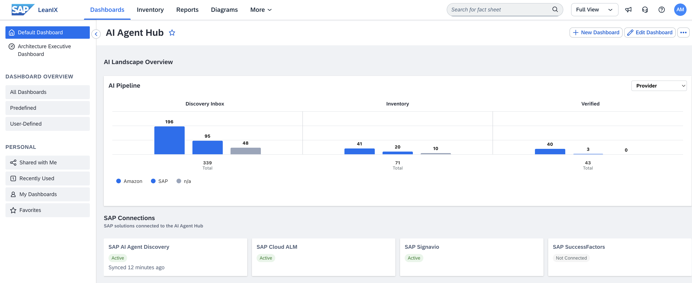
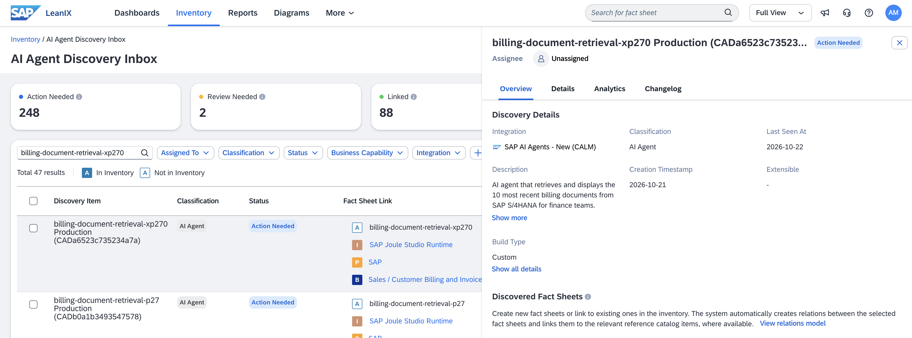
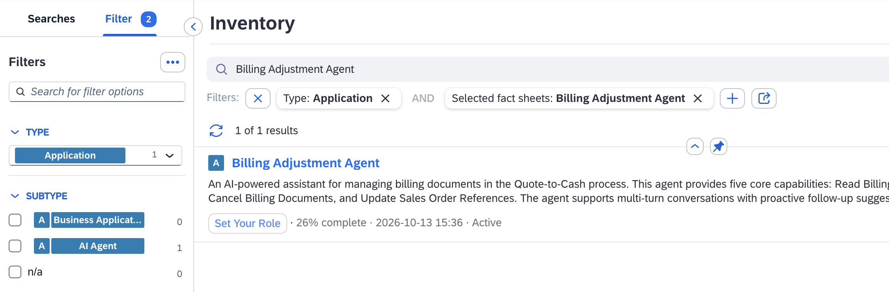
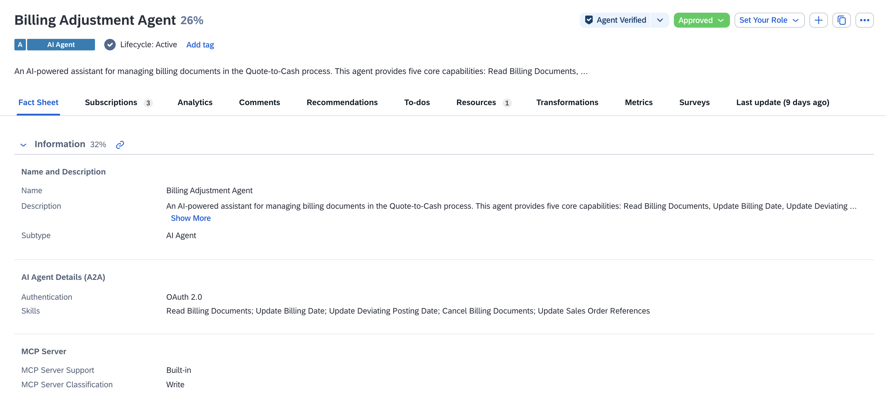
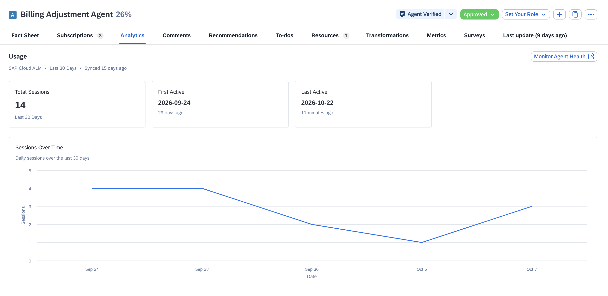
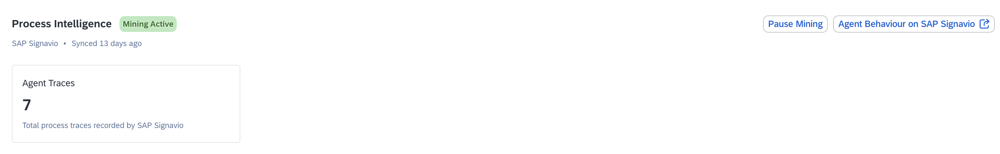

# Exercise 03 - Govern your agent in the SAP LeanIX - AI Agent Hub

Now that we understand our agent and can see it is healthy in Joule Studio, we switch hats. Joule Studio only sees the agents it runs; as the AI Governance Center of Excellence, we need the whole picture — every agent, MCP server, and LLM across the landscape — and a way to formally approve each one for production. That is what the **SAP LeanIX - AI Agent Hub** gives us.

At the end of this exercise, you'll be familiar with the agent information available in AI Agent Hub, the discovery of agents, the fact sheet structure, and analytics available for an agent.

> [!IMPORTANT]
> ***System details and credentials for this exercise 🔐***   
> The table below shows the system you will use in this exercise. Refer to [Exercise 00](../ex0/README.md) for the full credentials list.
>
> | System | URL | Credentials |
> | ---- | ---- | ---- |
> | SAP LeanIX — AI Agent Hub | https://url.sap/9rm72k | User `XP270-0NN` (your participant number) |

## Background

The AI Agent Hub automatically discovers agents from connected systems: standard SAP agents, custom agents deployed on Joule Studio, and third-party agents from platforms such as Microsoft Entra ID, Google Cloud, and AWS Bedrock. Whatever its origin, every agent goes through the same review-and-approve process before it enters the governed inventory. The Joule Studio finance agent has been discovered and is waiting for you.

> [!NOTE]
> Everyone shares one LeanIX workspace, so use your participant number (`XP270-0NN`) to find the agent throughout this exercise.

## Step 1 — Orient yourself in the AI Agent Hub

👉 In **SAP LeanIX**, open the [**AI Agent Hub Dashboard** ](https://de-6.leanix.net/trainingsystemarchitects/dashboard/529c2cda-ea2c-463c-bb5c-d24e1e7e8960) and get familiar with all the data available to us: **AI Landscape Overview**, **SAP Connections** feeding discovery data in — including Joule Studio, SAP Cloud ALM, and Signavio, the status of our AI Agent Discovery, verification of agents, analytics, etc. There is a lot of valuable data here.

> [!NOTE]
> **What you are seeing:** a real-time governance posture — how many agents exist, how many are verified, and how much AI activity is happening in your landscape right now. The **Inventory** holds everything known to the system; the **AI Agent Discovery Inbox** surfaces the items that need your attention.

## Step 2 — Find the Billing Document Retrieval agent in the Discovery Inbox

👉 Navigate to **Inventory → Inventory Tools** *(top right)* **→ Discovery Inbox → AI Agent Discovery**.

👉 Apply the filter **Status: Action Needed**, add the **Build Type: Custom** filter, then search for the ***billing-document-retrieval-xp270*** agent.

👉 Open your discovery item and review the **Overview** — what the agent claims to do, when it first appeared, its **Build Type** (Custom), and the **Discovered Fact Sheets**: the IT component (the Joule Studio runtime), the provider (SAP), and the agent itself (***billing-document-retrieval-xp270***).

👉 Navigate to the **Details** tab and note two links in particular:

- the **Joule Studio link**, which opens the agent project you explored in Exercise 2;
- the **Cloud Identity Services link**, which shows the agent's **identity record** — confirming the agent has a registered identity, so authentication, access policies, and user authorizations can be managed there. You will not have access to the Cloud Identity Services but screenshots have been provided in the workshop material for reference.

> [!IMPORTANT]
> **Why this matters:** the Details page shows whether the agent runs in a **productive** environment. If it does, real users may already be interacting with it — potentially against live SAP S/4HANA Cloud data — before any governance review has taken place. That is exactly the gap that an Enterprise Architect should be closing.

> [!TIP]
> If you want to learn more about the entire governance process of AI Agents in SAP LeanIX, check out **BT161 - SAP AI Agent Hub: AI Governance Workshop from Discovery to Decommissioning** (https://github.com/SAP-Samples/teched2026-BT161).

## Step 3 — The Billing Adjustment Agent

We've seen how to discover the Billing Document Retrieval agent in the AI Agent Hub and review its details. Now let's get familiar with the data available for a fully governed agent, e.g. Billing Adjustment Agent.

👉 Select the **Inventory** tab and filter the list by ***Billing Adjustment Agent***.

👉 Select the ***Billing Adjustment Agent*** and explore the fact sheet:

- **Relations Explorer** — visualize which IT components, business capabilities, and other fact sheets this agent is connected to
- **Analytics** tab — view usage data: sessions, first/last active
- **Verification status** — confirm the agent is verified; also check whether the **Billing Adjustment Agent** in the inventory is verified
- **Subscriptions** — see who is assigned as Responsible and Observer
- **Last Updated** tab — this is the change log for the fact sheet; it shows the history of every governance action taken on this record

> **This is your audit trail.** Every field change, subscription update, and verification decision is recorded here. This is what a complete governance record looks like when you have finished today's exercises.

## Step 4 — Agent Analytics in LeanIX

SAP LeanIX gets agent usage data from SAP Cloud ALM. This allows Enterprise Architects to understand how agents are being used, track their activity, and make informed governance decisions based on real usage metrics.

👉 Navigate to the fact sheet's **Analytics** tab. Here you can view usage data such as sessions, first active, and last active dates. These data comes from SAP Cloud ALM, you can see the Monitor Agent Health button on the top right corner, which will take you directly to SAP Cloud ALM.

There is also a connection with SAP Signavio where we can see if mining is active for the agent. Similar to Cloud ALM, we can access SAP Signavio directly by selecting the **Agent Behaviour on SAP Signavio** button.

> [!IMPORTANT]
> From SAP LeanIX we not only establish governance on our agents but we also control which data is mined in SAP Signavio. A fact sheet needs to be created for an agent so that we can initiate the mining process and its data to be available in SAP Signavio. Meaning, our ungoverned agents will not have their behaviour mined until they are properly registered and configured in SAP LeanIX.

## Summary

In this exercise, you have explored two agents: the Billing Document Retrieval agent and the Billing Adjustment Agent, one recently added and the other an existing governed agent. You have located them in the inventory, reviewed their fact sheets, examined their relations and analytics, and understood how SAP Cloud ALM and SAP Signavio integrate with LeanIX to provide usage and mining data.

## Further Study

* [AI Agent Discovery (SAP Help Portal)](https://help.sap.com/docs/LEANIX)
* [AI Agent Hub (reference architecture)](https://architecture.learning.sap.com/docs/ref-arch/jkg4j2)

## Next

Continue to 👉 [Exercise 04 - Manage access with SAP Cloud Identity Services](../ex4/README.md)
