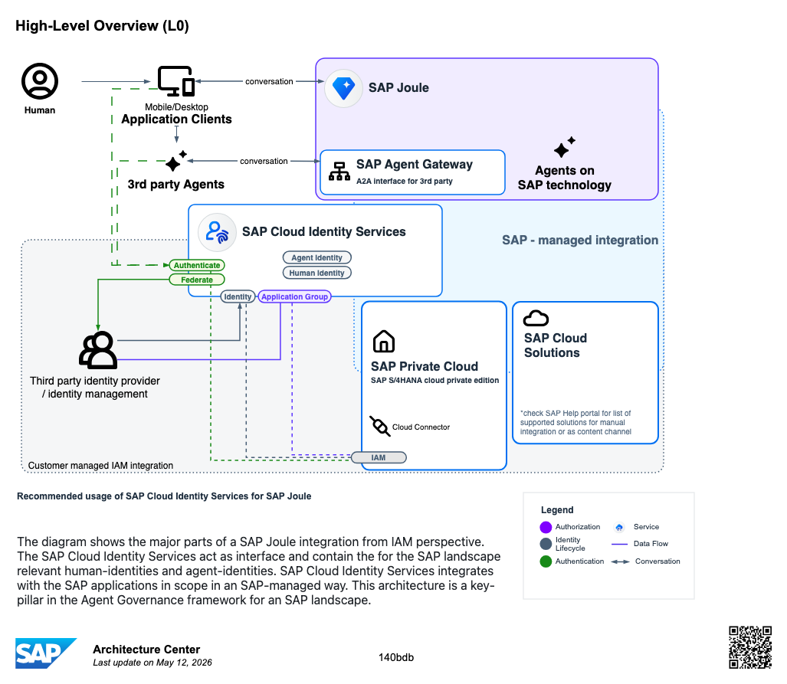
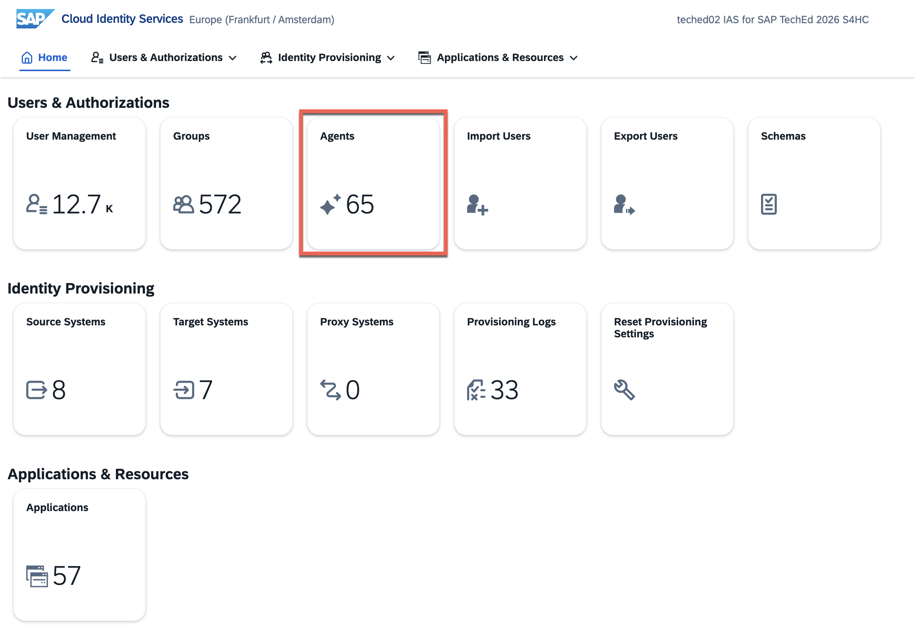
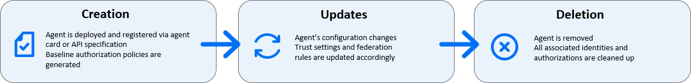
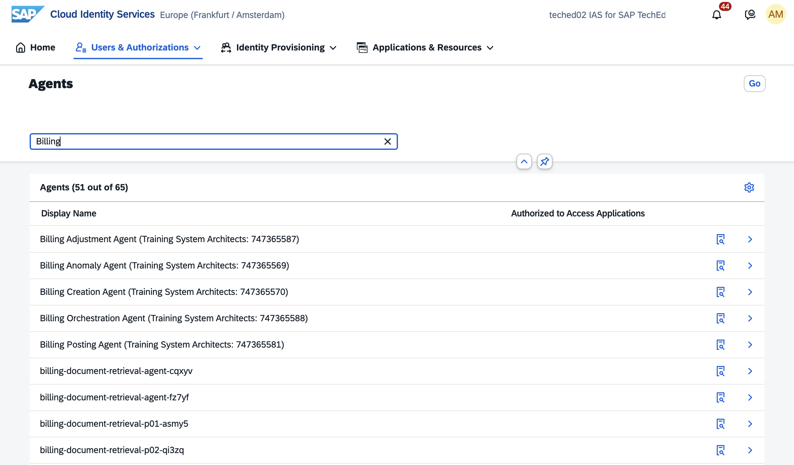
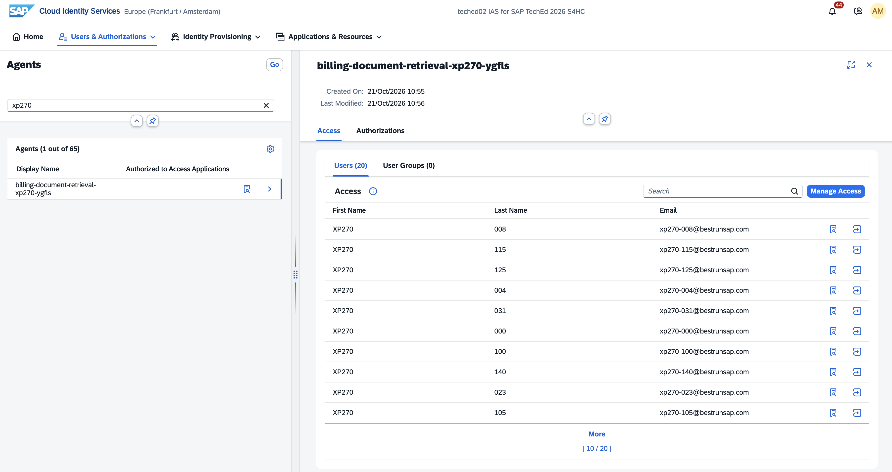

# Exercise 04 - Manage access with SAP Cloud Identity Services

Throughout this session, access has been "governed by the organization's existing authorization model" — but where does that model actually live for an agent? When the finance agent reads SAP S/4HANA Cloud data, *whose* permissions apply? The answer sits in **SAP Cloud Identity Services**.

At the end of this exercise, you'll have an understanding of how an agent's identity and authorizations are managed in SAP Cloud Identity Services, and how permissions are enforced at runtime.

> [!IMPORTANT]   System details and credentials for this exercise 🔐   
> The table below shows the system referenced in this exercise. Refer to [Exercise 00](../ex0/README.md) for the full credentials list.
>
> | System | URL | Credentials |
> | ---- | ---- | ---- |
> | SAP Cloud Identity Services | N/A | Presenter demo — no login required |

> [!IMPORTANT]
> This is a read-only exercise. Unfortunately, we cannot provide hands-on access to SAP Cloud Identity Services but following the explanations and screenshots in this exercise will give you a clear understanding of how it works. The screenshots correspond to the SAP Cloud Identity Services managing the access for the workshop's landscape.

## AI Agent Identity & Governance in SAP Landscapes

The following diagram shows the major components of the SAP Joule integration from an IAM perspective at a leadership level. SAP Cloud Identity Services act as the central interface containing the SAP-landscape-relevant human identities and agent identities. SAP Cloud Identity Services integrates with the SAP applications in scope in an SAP-managed way. This architecture is a key pillar in the Agent Governance framework for an SAP landscape.

> [!TIP]  AI Agent Identity & Governance in SAP Landscapes - Reference architecture  
> To learn more about the reference architecture please visit: https://architecture.learning.sap.com/docs/ref-arch/140bdb

## What is an Agent in SAP Cloud Identity Services?

Agent identity represents AI and automation agents in SAP Cloud Identity Services. Agents can authenticate, receive authorization, and be managed like human users while retaining agent-specific capabilities and security controls.

From an identity and access management perspective, an agent is an application registered in SAP Cloud Identity Services. Each deployed agent appears in the **Agents** tile of the SAP Cloud Identity Services administration console, where you can review its authorization policies, inspect which APIs it can call, and control which users or groups can invoke it.

You can't create or delete agents through the administration console. The SAP platform automatically manages their lifecycle in response to deployment events. When an agent is deployed, SAP Cloud Identity Services registers it using the agent's own metadata (its agent card or API specification) and generates baseline authorization policies at that point. When the agent's configuration changes, the system updates trust settings and federation rules in a controlled, traceable manner. When an agent is removed, the system fully cleans up all associated identities and authorizations. To control which users or user groups can invoke an agent, we access the **Agents** tile in the administration console.

SAP supports three categories of agents, each with a different level of administrator control:

- LOB agents: The system provisions LOB agents as part of SAP line-of-business solutions such as SAP S/4HANA Cloud or SAP SuccessFactors.
- Custom agents: Customers or partners build agents, for example using Joule Studio.
- Third-party agents: Third-party agents are external AI tools that connect to the SAP landscape through the agent gateway.

The system manages authorizations in two phases for increased security:

- Central Authorization in SAP Cloud Identity Services: Defines who can access an agent. This allows you to restrict agent access and provides visibility into the authorizations the agent has.
- Principal Propagation: The agent works on behalf of the current user. Each application and back end checks the user's authorizations, ensuring that the agent can only access what the user has permission to access.

This two-phase approach ensures security even when workflows span multiple runtime types.

> [!NOTE]
> Agents always act on behalf of a human user. The agent user is used to assign authorization policies and user groups to the agent. These assignments define what the agent can do. In a future release, agents will be able to act on their own behalf without a human user context.

## Agents in Cloud Identity Services

👉 In **SAP Cloud Identity Services**, navigate to the **Agents** tile in administration view.

Once we select an agent from the list, we can view all the users and groups that have been granted access to the agent.

If authorizations have been defined for the agent, they will be listed in the Authorizations tab.

## Agents and Assistants

In Joule, an assistant is a higher-level AI entity that translates user intent into actions by coordinating agents. An assistant and each agent it invokes are separate registered identities in SAP Cloud Identity Services. Each requires its own user access assignment.

Access assignments are not inherited. If an assistant invokes one or more agents, assigning a user to the assistant does not automatically grant them access to those agents. You must assign the user to the assistant and to each agent it invokes separately. If any assignment is missing, the user receives an authorization error when the assistant attempts to invoke the unassigned agent, even if the user has access to all the other entities.

## Summary

You now know where an agent's identity truly lives — SAP Cloud Identity Services — the different categories of agents and how the system manages authorizations in two phases. This is the access-control foundation relevant to grant the appropriate Agent and Assistants access to users.

## Further Study

* [Agents in SAP Cloud Identity Services](https://help.sap.com/docs/cloud-identity-services/cloud-identity-services/agents?locale=en-US&version=Cloud&ai=true)
* [Agentic AI and AI Agents on SAP Business AI Platform (reference architecture)](https://architecture.learning.sap.com/docs/ref-arch/98efa0)
* [AI Agent Identity & Governance in SAP Landscapes](https://architecture.learning.sap.com/docs/ref-arch/140bdb)

## Next

Continue to 👉 [Exercise 05 - Observe your agent in SAP Cloud ALM](../ex5/README.md)
