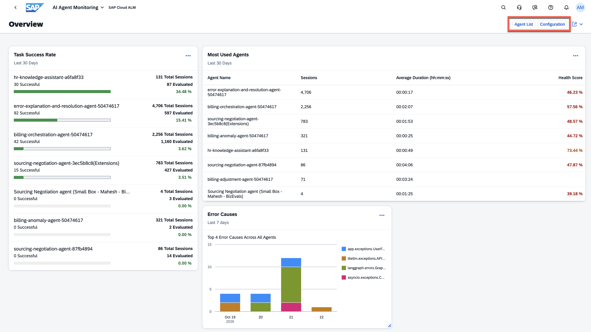
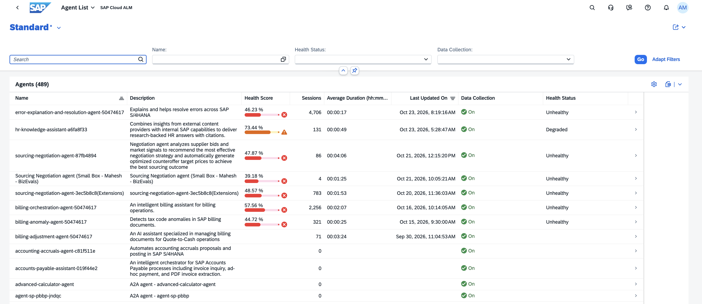
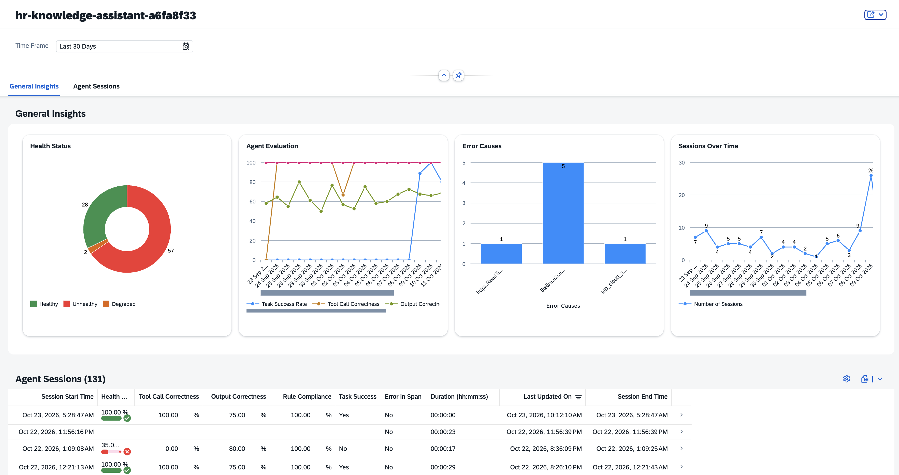
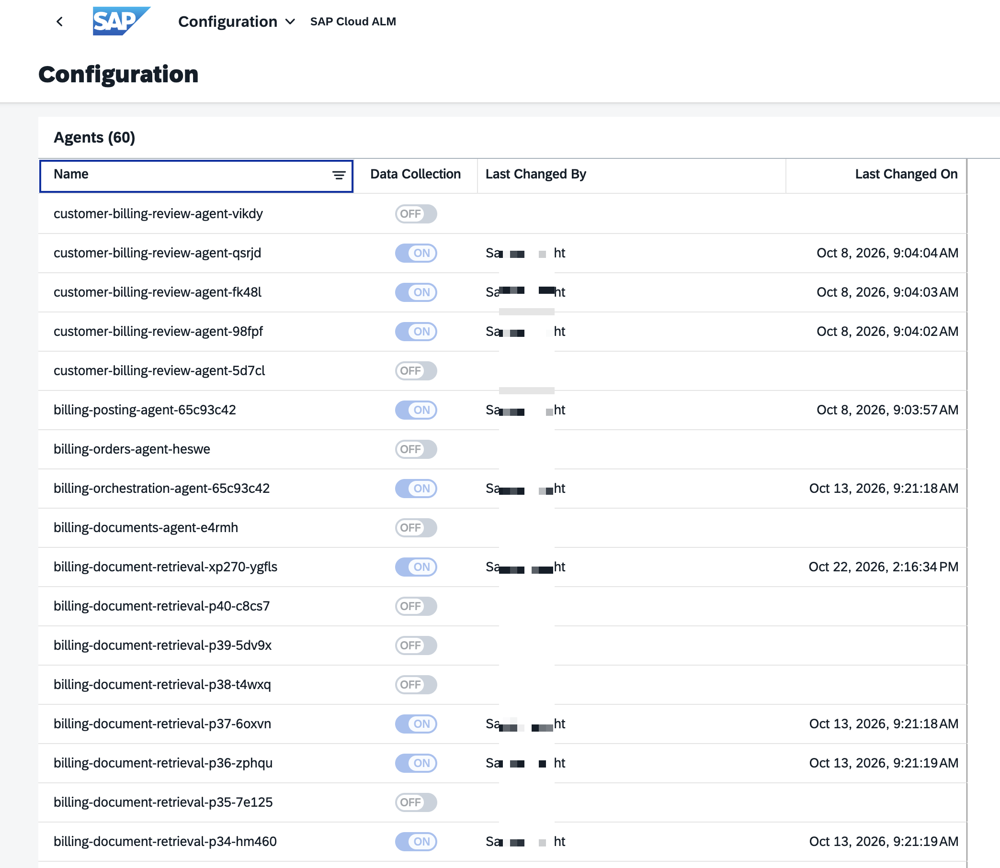
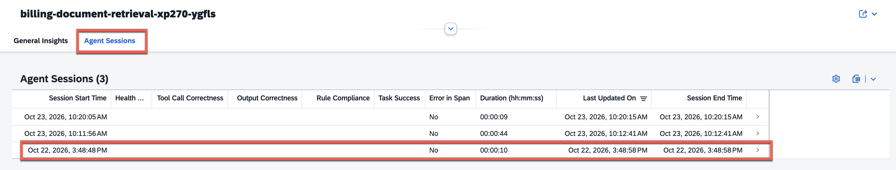
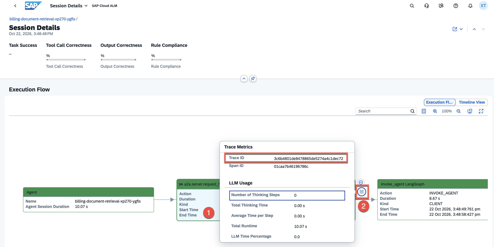
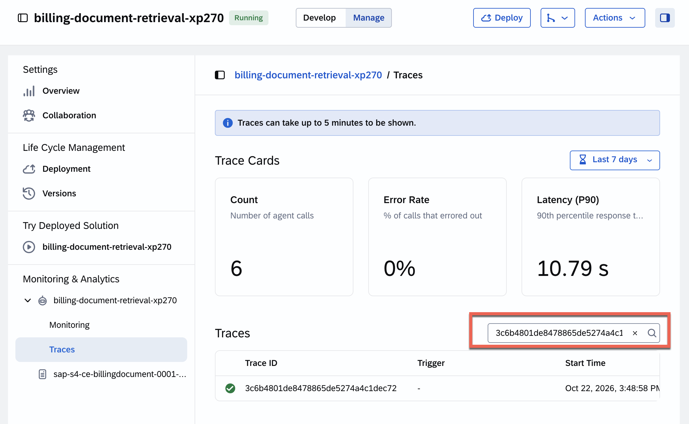
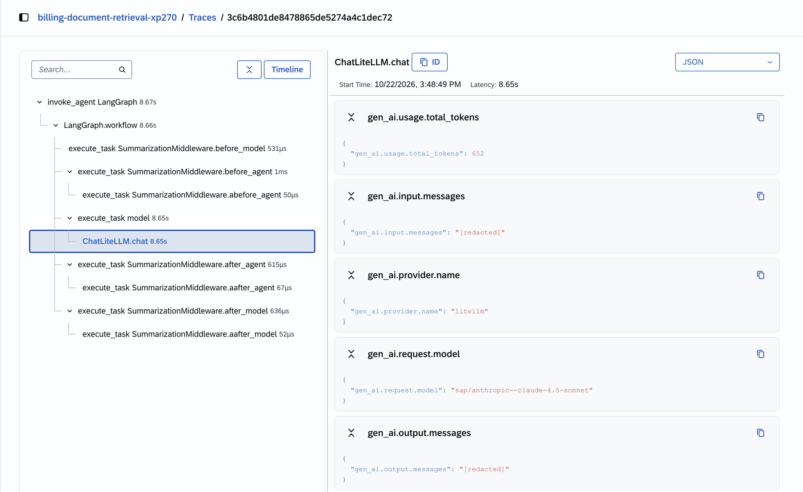

# Exercise 05 - Observe your agent in SAP Cloud ALM

In Exercise 2 we watched our agent's health from the *build* side, in Joule Studio. In Exercise 3 we learned how to put some governance on our agents and in Exercise 4 we established its identity and access. Now we look at the dedicated **operations** view. In an enterprise, day-to-day production health is typically watched by an operations team — and the tool they use for that across SAP solutions is **SAP Cloud ALM**.

At the end of this exercise, you'll have an understanding of how agent telemetry reaches SAP Cloud ALM and what the operations team watches there.

> [!IMPORTANT]
> ***System details and credentials for this exercise 🔐***   
> The table below shows the system referenced in this exercise. Refer to [Exercise 00](../ex0/README.md) for the full credentials list.
>
> | System | URL | Credentials |
> | ---- | ---- | ---- |
> | SAP Cloud ALM | https://url.sap/a3ml53 | User `XP270-0NN` (your participant number) |

## How telemetry gets to Cloud ALM

Session telemetry from SAP-managed agents flows automatically into **SAP Cloud ALM**, where it drives performance dashboards. This is the same execution data you saw in Joule Studio — but presented for operations: aggregated across agents, trended over time, and designed for someone watching the whole landscape rather than debugging a single solution.

> [!NOTE]
> Recall the SAP Connections section in the AI Agent Hub dashboard from Exercise 3 — **SAP Cloud ALM** was one of them. The AI Agent Hub also surfaces this observability so governance and operations share a consistent view.

> [!IMPORTANT]  Screenshots in this exercise  
> The screenshots shown in this exercise are from a different environment. The data in the tenant we have access to does not reflect the screenshots. **This is on purpose.** We want to show you the bleeding edge of the product, which will be available in a week time max. That said, still follow the steps and compare them with what you see in your environment. To clearly identify screenshots from our bleeding edge environment, look for the following text before the screenshot - ⚠️ *Screenshot from prerelease environment* 🏎️.

## Step 1 — Access AI Agent Monitoring

**AI Agent Monitoring** is a unified observability solution that provides end-to-end visibility into the full lifecycle of AI agent execution. It brings together real-time session health tracking, distributed session tracing, performance analytics into a single operational view—covering everything from LLM calls and tool invocations, across every AI agent deployed in your tenant.

👉 Open **SAP Cloud ALM** and sign in with the shared workspace credentials. From the Cloud ALM home, navigate to the **Operations** tab. You'll find here the **AI Agent Monitoring** tile

As the dashboard is shown, note the different tiles available and the most used agents for the past 30 days. 

> ⚠️ *Screenshot from prerelease environment* 🏎️

For the configured agents, you can view the following cards:

- Task Success Rate: Task Success Rate is the rate of tasks completed successfully. For an agent if the Task Success Rate is 70%, it means that 70% of the tasks in the agent are completed successfully without errors.
- Most Used Agents: Most Used Agents displays the agents that are most actively used sorted based on their number of sessions. We can view name, number of sessions, latency, and health score.
- Error Causes: Error Causes displays a classification of errors that have occurred during a session for an agent. We can view the total number of errors that have occurred in the last one week and a plot of error causes against time.

## Step 2 - Agent List

In the **Agent List** , we can view all the agents that are monitored by SAP Cloud ALM.

> ⚠️ *Screenshot from prerelease environment* 🏎️

We can view and monitor various metrics for the agents in your tenant, for example:

- Name
- Description
- Health score: Green (100-90) , Yellow (89-70), or Red (69-0)
- Health status: Possible statuses are - healthy, degraded, unhealthy.
- Sessions: Number of times the agent has run

When selecting an agent from the list we can view detailed information about the agent, including its sessions, health status, and error causes. This allows us to monitor the agent's performance and troubleshoot any issues that may arise.

> ⚠️ *Screenshot from prerelease environment* 🏎️

## Step 3 - Configuration

👉 From the **AI Agent Monitoring** dashboard, select the **Configuration** button on the top right corner to access the Agent Configuration screen.

In the **Configuration** section, we can review all the data and adjust if we want to collect data for our agent.

> [!NOTE]
> The users provided for this hands-on don't have the access to modify the agent configuration. Therefore, the button is greyed out.

## Step 4 — Connect it back to what you've seen

Now, in our Cloud ALM environment, we want to trace how the signals we observed relate to the actual agent activity captured in Joule Studio.

👉 In AI Agent Monitoring, go to the ***billing-document-retrieval-xp270*** agent and select the session for ***October 22, 2026 at 3:48:58 PM***.

This will open the trace you want to investigate and we can see the Execution Flow. To view the trace details, select an individual step and choose the Trace Metrics button. A pop-up will display the relevant metrics for that step.

👉 Copy the Trace ID from the Cloud ALM trace (`3c6b4801de8478865de5274a4c1dec72`) and search for it in Joule Studio to locate the corresponding trace.

👉 In Joule Studio, go to the agent's **Monitoring & Analytics** > **Traces** and search for the copied Trace ID.

👉 Select the trace and you will see the execution flow for that trace as shown in the screenshot below.

> [!Note]
> This is the same trace we observed in exercise 2.

👉 As you explore, map each Cloud ALM signal to its Joule Studio counterpart from Exercise 2. Note the agent traces in Joule Studio and compare them with what you see in Cloud ALM.

> [!TIP]
> The distinction here is about audience, not data. **Joule Studio** monitoring is where a *developer* validates a change or investigates a specific trace. **Cloud ALM** is where *operations* watches production health across many agents and decides when to escalate. When operations finds a failing run they cannot resolve, they hand the **trace ID** back to the developer — closing the loop you saw in Exercise 2.

## Summary

We've seen how agent telemetry flows into SAP Cloud ALM and what an operations team watches there — evaluation rates, error patterns, session volumes, and trends — and how that complements the developer-facing monitoring in Joule Studio. In the next exercise we look at agent *behaviour* with SAP Signavio.

## Further Study

* [SAP Cloud ALM](https://help.sap.com/docs/cloud-alm?locale=en-US)
* [AI Agent Monitoring](https://help.sap.com/docs/cloud-alm/applicationhelp/ai-agent-monitoring?locale=en-US)
* [AI Agent Hub (reference architecture)](https://architecture.learning.sap.com/docs/ref-arch/jkg4j2)

## Next

Continue to 👉 [Exercise 06 - Observe agent behaviour with SAP Signavio](../ex6/README.md)
