# Exercise 06 - Observe agent behaviour with SAP Signavio

Metrics tell us *whether* an agent is healthy but they don't tell us *how it actually behaves*. Does our finance agent follow the process we expect? Where does it deviate? Which paths are slow or wasteful? Answering that is **process intelligence** applied to agents — and in the SAP landscape that is **SAP Signavio**.

At the end of this exercise, you'll have an understanding of how SAP Signavio mines an agent's execution traces to reveal its real behaviour, and how that complements the monitoring and governance you've already done.

> [!IMPORTANT]
> ***System details and credentials for this exercise 🔐***   
> The table below shows the system you will use in this exercise. Refer to [Exercise 00](../ex0/README.md) for the full credentials list.
>
> | System | URL | Credentials |
> | ---- | ---- | ---- |
> | SAP Signavio | https://url.sap/p851or | User `XP270-0NN` (your participant number) |

## Agent Mining

As AI agents become more autonomous, their behaviour becomes more ambiguous. Their decisions happen in milliseconds, driven by complex reasoning or LLM-based inference that isn't visible to the people relying on the results. That leaves critical questions unanswered:

- What specific actions is my agent taking within my processes, and how are they impacting them?
- Is it acting in compliance with my rules and policies?
- How much does it cost to run?
- Is it actually delivering measurable business value?

Without transparency, you risk agents that look efficient on paper but behave unpredictably in practice — introducing errors, inefficiencies, or unnecessary cost.

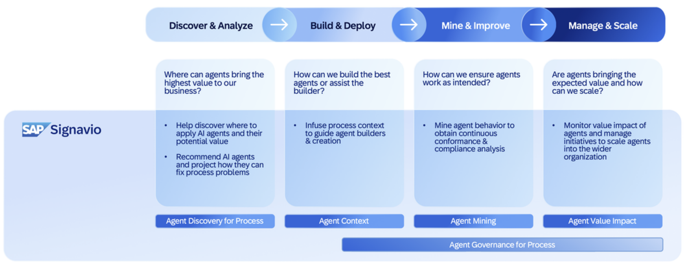

Every run your agent performs leaves an execution trace — the same raw material you inspected in Joule Studio. **SAP Signavio** ingests these traces and applies **agent mining** to turn invisible autonomy into something you can see, measure, and improve:

- **Trace agent behaviour** — see how the agent makes decisions, navigates process steps, and adapts to different contexts, reconstructed into real process flows
- **Analyze impact** — measure the agent's influence on key metrics like process time, accuracy, and compliance
- **Monitor cost** — track the computational and LLM-related expense of each run to keep performance cost-efficient
- **Benchmark performance** — compare agent iterations and paths across the landscape to find the slow or costly ones and target refinement

Agent mining is available natively for **SAP Joule Agents**, and it extends to **third-party or custom-built agents** too — a single, unified lens across the whole AI landscape.

> [!NOTE]
> This is the same discipline SAP Signavio applies to business processes, now pointed at agents. Instead of mining how a purchase order flows through our systems, we mine how an agent flows through its own decisions and tool calls.

### Is it just agent monitoring?

Agent mining is more than monitoring. It is how we move from *running* agents to running them responsibly at scale, letting you:

- **Increase transparency** into agent behaviour and decision logic
- **Control operational cost** by understanding and optimizing LLM usage
- **Ensure compliance** through auditable decision trails
- **Continuously improve performance** by learning from live execution
- **Measure true business value**, not just raw efficiency metrics

The goal is that our agents don't just *work* — but work *transparently*, *efficiently*, and *strategically*.

## Step 1 — Open SAP Signavio

👉 Open **SAP Signavio** and expand the Mine and Analyze section. Select **Analysis Configuration**.

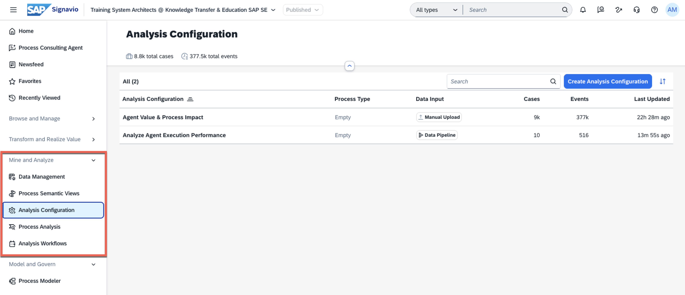

An analysis configuration is created in SAP Signavio Process Intelligence for the end-to-end processes that we want to analyse. There are two configurations available to us:

- Agent Value & Process Impact
- Analyze Agent Execution Performance

> [!IMPORTANT]
> The configuration above have been set up in the tenant to facilitate the analysis of agent behaviour. The ***Agent Value & Process Impact*** configuration is what customers currently get in their tenant by default and ***Analyze Agent Execution Performance*** is a sneak preview on upcoming dashboard that will be available soon.

## Step 2 — Explore the Analyze Agent Execution Performance configuration

The ***Analyze Agent Execution Performance*** configuration provides a high-level overview of your AI agent operations. This configuration is connected to live system data as you can see in the **Data Input** column, its source is a **Data Pipeline**.

> [!NOTE]
> THe XP270 users don't have access to the Data Pipeline itself, the screenshots below show the administrator view with access to the data pipeline object.

### The Analyze Agent Execution Performance data pipeline

Under the **Mine and Analyze** section, we get the Data Management section (we can see it in the previous screenshot). Within this section, we can access the data pipeline that feeds the ***Analyze Agent Execution Performance*** configuration.

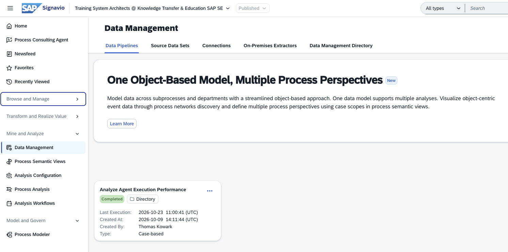

In a data pipeline, you define how the pipeline extracts and transforms data, and where to load the data. A data pipeline can have different source data systems. In the case of the ***Analyze Agent Execution Performance*** configuration, the source is the live SAP-managed system. For a transformed data to be available for custom analysis, you must link analysis configuration to a data pipeline. Within the data pipeline, we can see the overview, connections, schedule and pipeline log.

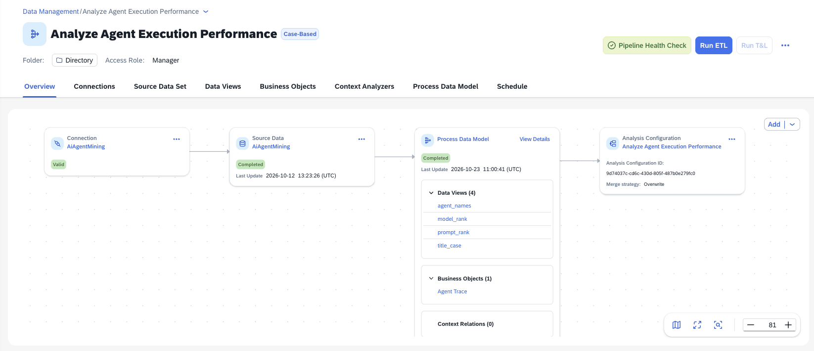

We can inspect the data provided from our data source. In the case of the ***AiAgentMining*** data source, we can see the ***AgentMetadata*** table and all its columns. You might remember seeing this data in SAP LeanIX when checking out the fact sheet for the ***Billing Adjustment Agent***. 

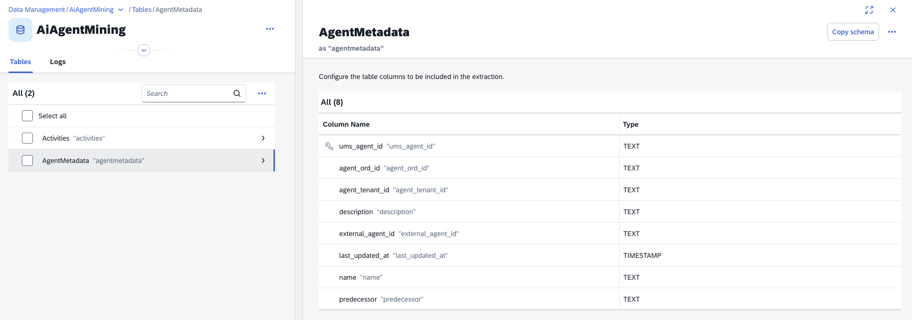

We can also control how often the ETL process runs to extract, transform, and load the data from the source system into the pipeline. Lets remember that analysing process data doesn't necessarily require to be real-time; it can be scheduled according to the needs of the analysis.

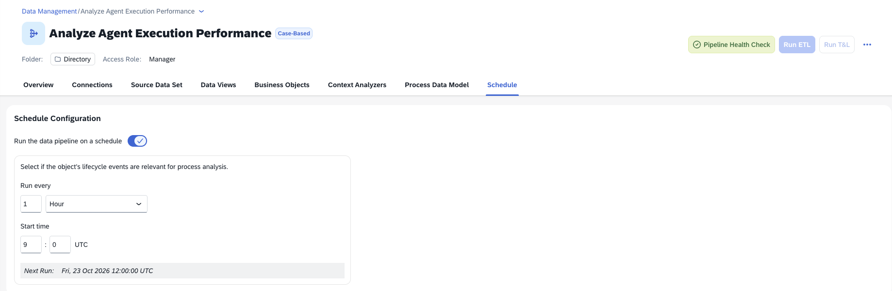

Back in the Overview of the data pipeline, we can see the 10 most recent runs of the pipeline. This allows us to track the execution history, identify any failures or delays, and ensure that the data is being processed as expected. In the log below we can see how it is running on a schedule and it also includes a manual run.

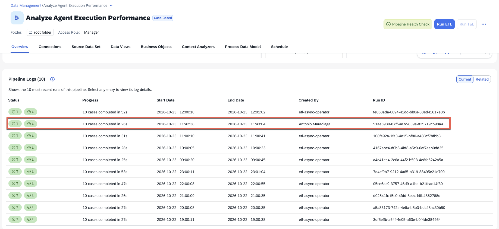

### The Analyze Agent Execution Performance dashboard

👉 Select the ***Analyze Agent Execution Performance*** configuration and then the dashboard available.

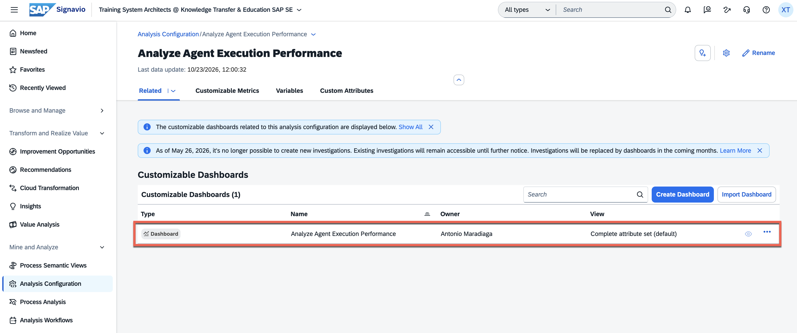

As mentioned in exercise 3, agent data shown in Signavio is available only if we've first enabled Agent Mining in the agent fact sheet in SAP LeanIX. Therefore, we will not see all agents from the landscape here.

👉 We are in the ***Improve AI Agent Operations*** tab of the dashboard. Explore the data available here.

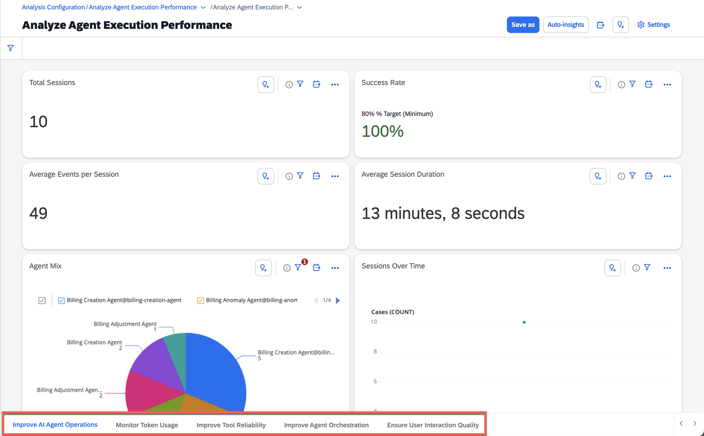

Within the dashboard, we can navigate through multiple tabs to analyze different aspects of agent performance and impact.

👉 Navigate to the ***Ensure User Interaction Quality*** tab and explore the data available.

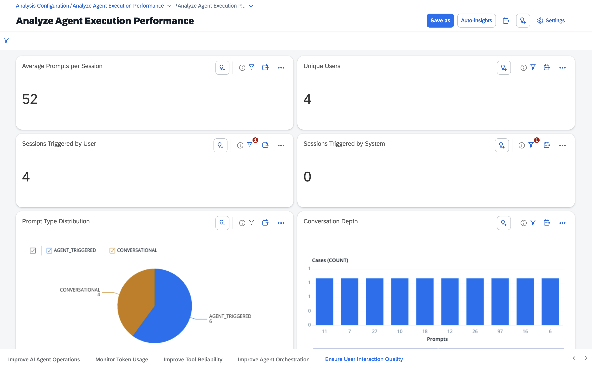

## Step 3 — Explore the Agent Value & Process Impact configuration

Now, we will explore the ***Agent Value & Process Impact*** dashboard to give you a glimpse of the future potential and impact of AI agents on business processes. There is a shift here where we focus more on the business side of things and different terminology is being used, e.g. having an understanding on the different business objects involved and how agents contribute to their value and process impact.

👉 Navigate to **Mine and Analyze** > **Process Analysis**. Select the ***Agent Value & Process Impact*** dashboard and get familiar with the data presented there.

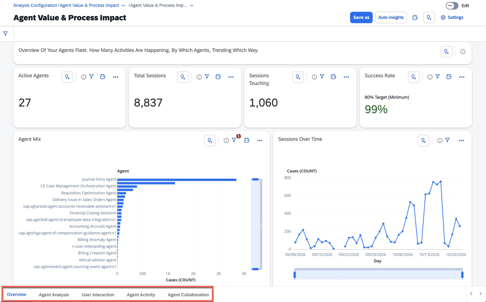

> [!IMPORTANT]
> **Why this matters:** behaviour mining closes the operate loop. Monitoring (Joule Studio, Cloud ALM) tells you an agent needs attention; governance (AI Agent Hub) controls its lifecycle and approval; and behaviour mining (Signavio) gives you the evidence to decide *what to change* — refine a prompt, fix a tool, or retire the agent.

## Summary

We've seen how SAP Signavio turns raw execution traces into mined behaviour — real process flows, conformance to the expected process, and performance benchmarking across the landscape. Together with Joule Studio monitoring, Cloud ALM operations dashboards, the AI Agent Hub governance record, and the Cloud Identity Services access model, you now have the full picture of operating an agent responsibly at scale: build, monitor, govern, observe, and improve.

That completes the hands-on workshop. You have operated an AI agent end to end: understood it, monitored it in Joule Studio, understood its governance in the AI Agent Hub, got familiar with its identity in Cloud Identity Services, observed it in Cloud ALM, and mined its behaviour with Signavio — the full operations and governance picture for enterprise AI agents on the SAP Business AI Platform.

## Further Study

* [SAP Signavio Process Intelligence](https://help.sap.com/docs/signavio-process-intelligence?locale=en-US)
* [Data Pipelines in SAP Signavio](https://help.sap.com/docs/signavio-process-intelligence/onboarding-and-data-integration-guide/data-pipelines?locale=en-US)
* [SAP AI Agent Mining connector](https://help.sap.com/docs/signavio-process-intelligence/onboarding-and-data-integration-guide/connector-sap-ai-agent-mining?locale=en-US&version=SHIP&state=PRODUCTION)
* [Agentic AI and AI Agents on SAP Business AI Platform (reference architecture)](https://architecture.learning.sap.com/docs/ref-arch/98efa0)

## Next

Return to the 👉 [hands-on workshop overview](../../README.md).
